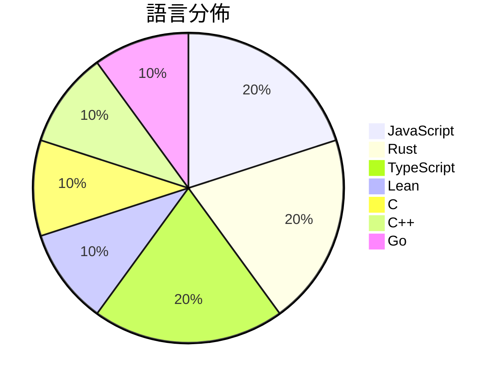

# GitHub Trending - 2026-10-08

> [!summary] 本日摘要
> 收錄 **10** 個新專案，合計 **24.9k** stars
> 語言分佈：JavaScript (2) · Rust (2) · TypeScript (2) · Lean (1) · C (1) · C++ (1) · Go (1)

> [!tip] 本週焦點
> **[[openai--math|openai/math]]** — 1 天內累積 10.5k stars（10.5k stars/天）
> 



---

## 收錄列表

| # | 專案 | 分類 | Stars | 速度 | 安裝 | 語言 | 用途 |
| :--: | --- | --- | ---: | ---: | --- | --- | --- |
| 1 | [[openai--math\|openai/math]] |  | 10.5k | 10.5k/天 |  | Lean |  |
| 2 | [[QingYunA--answer-me-with-html\|QingYunA/answer-me-with-html]] |  | 2.2k | 438/天 |  | JavaScript | Answer me with HTML — an agent skill tha |
| 3 | [[alchaincyf--huashu-art-motion\|alchaincyf/huashu-art-motion]] |  | 2.0k | 986/天 |  | JavaScript | 艺术动画skill：35种艺术风格、9种解说语法，用代码让画动起来。 |
| 4 | [[storytold--effectcraft\|storytold/effectcraft]] |  | 1.9k | 314/天 |  | Rust |  |
| 5 | [[facebookincubator--muse-gadget-sdk\|facebookincubator/muse-gadget-sdk]] |  | 1.7k | 340/天 |  | C | Open source SDK to build Muse gadgets |
| 6 | [[deadinside28--bloodborne_pc\|deadinside28/bloodborne_pc]] |  | 1.7k | 243/天 |  | C++ |  |
| 7 | [[kargulstudio--sales-crm\|kargulstudio/sales-crm]] |  | 1.6k | 548/天 |  | TypeScript |  |
| 8 | [[lucasmarkes--hairline\|lucasmarkes/hairline]] |  | 1.2k | 196/天 |  | TypeScript | Six isometric line figures that answer t |
| 9 | [[storytold--designcraft\|storytold/designcraft]] |  | 1.1k | 185/天 |  | Rust |  |
| 10 | [[mizorewww--x_gift_bot\|mizorewww/x_gift_bot]] |  | 1.0k | 201/天 |  | Go | X Premium gift CLI and redemption site |

---

## 重點摘要

### 1. [[openai--math|openai/math]]

**10.5k** stars · **10.5k** stars/天 · Lean

---

### 2. [[QingYunA--answer-me-with-html|QingYunA/answer-me-with-html]]

**2.2k** stars · **438** stars/天 · JavaScript

---

### 3. [[alchaincyf--huashu-art-motion|alchaincyf/huashu-art-motion]]

**2.0k** stars · **986** stars/天 · JavaScript

---

### 4. [[storytold--effectcraft|storytold/effectcraft]]

**1.9k** stars · **314** stars/天 · Rust

---

### 5. [[facebookincubator--muse-gadget-sdk|facebookincubator/muse-gadget-sdk]]

**1.7k** stars · **340** stars/天 · C

---

### 6. [[deadinside28--bloodborne_pc|deadinside28/bloodborne_pc]]

**1.7k** stars · **243** stars/天 · C++

---

### 7. [[kargulstudio--sales-crm|kargulstudio/sales-crm]]

**1.6k** stars · **548** stars/天 · TypeScript

---

### 8. [[lucasmarkes--hairline|lucasmarkes/hairline]]

**1.2k** stars · **196** stars/天 · TypeScript

---

### 9. [[storytold--designcraft|storytold/designcraft]]

**1.1k** stars · **185** stars/天 · Rust

---

### 10. [[mizorewww--x_gift_bot|mizorewww/x_gift_bot]]

**1.0k** stars · **201** stars/天 · Go

---

## 今日到期複習

> [!tip] 根據間隔複習排程，今天該回顧的專案

```dataview
TABLE
  stars_per_day AS "Stars/天",
  category AS "分類",
  engagement AS "參與度"
FROM "Repos"
WHERE next_review AND date(next_review) <= date("2026-10-08") AND status != "archived"
SORT priority DESC
```

## 待處理

```dataviewjs
const pending = dv.pages('"Repos"').where(p => p.status === "to-review").length;
const unrated = dv.pages('"Repos"').where(p => p.status !== "archived" && p.status !== "to-review" && (p.my_rating || 0) === 0).length;
const noVerdict = dv.pages('"Repos"').where(p => p.status !== "archived" && (p.my_rating || 0) > 0 && (!p.verdict || p.verdict === "")).length;
const items = [];
if (pending > 0) items.push(`**${pending}** 個待分流`);
if (unrated > 0) items.push(`**${unrated}** 個已讀但未評分`);
if (noVerdict > 0) items.push(`**${noVerdict}** 個已評分但無結論`);
if (items.length > 0) dv.paragraph(items.join(" / "));
else dv.paragraph("所有專案都已處理完畢！");
```
