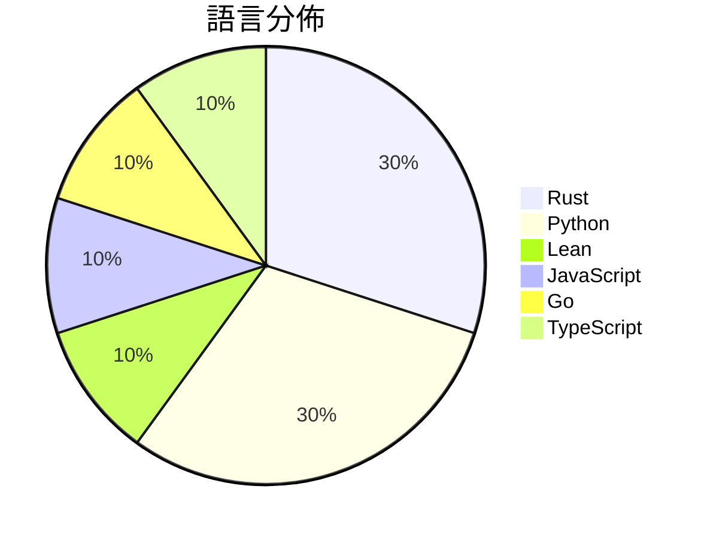

# GitHub Trending - 2026-10-10

> [!summary] 本日摘要
> 收錄 **10** 個新專案，合計 **31.2k** stars
> 語言分佈：Rust (3) · Python (3) · Lean (1) · JavaScript (1) · Go (1) · TypeScript (1)

> [!tip] 本週焦點
> **[[openai--math|openai/math]]** — 3 天內累積 13.3k stars（4.4k stars/天）
> 



---

## 收錄列表

| # | 專案 | 分類 | Stars | 速度 | 安裝 | 語言 | 用途 |
| :--: | --- | --- | ---: | ---: | --- | --- | --- |
| 1 | [[openai--math\|openai/math]] |  | 13.3k | 4.4k/天 |  | Lean |  |
| 2 | [[alchaincyf--huashu-art-motion\|alchaincyf/huashu-art-motion]] |  | 3.0k | 754/天 |  | JavaScript | 艺术动画skill：35种艺术风格、9种解说语法，用代码让画动起来。 |
| 3 | [[mhtsec--ARTEX\|mhtsec/ARTEX]] |  | 2.5k | 1.2k/天 |  | Go | AI 自主渗透测试系统 | 百度“agent+”攻防挑战赛冠军项目 |
| 4 | [[storytold--wordcraft\|storytold/wordcraft]] |  | 2.1k | 1.1k/天 |  | Rust | An open-source, clean-room reimplementat |
| 5 | [[zhongerxin--iPhone-use\|zhongerxin/iPhone-use]] |  | 2.1k | 710/天 |  | Python | 让 Codex 通过 USB 操作真实 iPhone：引导安装、App 自动化、 |
| 6 | [[nullmoth--nvidia-macos-driver\|nullmoth/nvidia-macos-driver]] |  | 2.0k | 1.0k/天 |  | Rust | Metal driver for NVIDIA GeForce RTX card |
| 7 | [[kargulstudio--sales-crm\|kargulstudio/sales-crm]] |  | 1.7k | 335/天 |  | TypeScript |  |
| 8 | [[LosaLosSantos--aurelio-finance\|LosaLosSantos/aurelio-finance]] |  | 1.6k | 519/天 |  | Python | Open-source personal finance app with an |
| 9 | [[storytold--cadcraft\|storytold/cadcraft]] |  | 1.5k | 488/天 |  | Rust | CADCraft: computer-aided design and draf |
| 10 | [[Jakeschincariol--replica-skill\|Jakeschincariol/replica-skill]] |  | 1.4k | 238/天 |  | Python | Eleven free Claude skills that clone any |

---

## 重點摘要

### 1. [[openai--math|openai/math]]

**13.3k** stars · **4.4k** stars/天 · Lean

---

### 2. [[alchaincyf--huashu-art-motion|alchaincyf/huashu-art-motion]]

**3.0k** stars · **754** stars/天 · JavaScript

---

### 3. [[mhtsec--ARTEX|mhtsec/ARTEX]]

**2.5k** stars · **1.2k** stars/天 · Go

---

### 4. [[storytold--wordcraft|storytold/wordcraft]]

**2.1k** stars · **1.1k** stars/天 · Rust

---

### 5. [[zhongerxin--iPhone-use|zhongerxin/iPhone-use]]

**2.1k** stars · **710** stars/天 · Python

---

### 6. [[nullmoth--nvidia-macos-driver|nullmoth/nvidia-macos-driver]]

**2.0k** stars · **1.0k** stars/天 · Rust

---

### 7. [[kargulstudio--sales-crm|kargulstudio/sales-crm]]

**1.7k** stars · **335** stars/天 · TypeScript

---

### 8. [[LosaLosSantos--aurelio-finance|LosaLosSantos/aurelio-finance]]

**1.6k** stars · **519** stars/天 · Python

---

### 9. [[storytold--cadcraft|storytold/cadcraft]]

**1.5k** stars · **488** stars/天 · Rust

---

### 10. [[Jakeschincariol--replica-skill|Jakeschincariol/replica-skill]]

**1.4k** stars · **238** stars/天 · Python

---

## 今日到期複習

> [!tip] 根據間隔複習排程，今天該回顧的專案

```dataview
TABLE
  stars_per_day AS "Stars/天",
  category AS "分類",
  engagement AS "參與度"
FROM "Repos"
WHERE next_review AND date(next_review) <= date("2026-10-10") AND status != "archived"
SORT priority DESC
```

## 待處理

```dataviewjs
const pending = dv.pages('"Repos"').where(p => p.status === "to-review").length;
const unrated = dv.pages('"Repos"').where(p => p.status !== "archived" && p.status !== "to-review" && (p.my_rating || 0) === 0).length;
const noVerdict = dv.pages('"Repos"').where(p => p.status !== "archived" && (p.my_rating || 0) > 0 && (!p.verdict || p.verdict === "")).length;
const items = [];
if (pending > 0) items.push(`**${pending}** 個待分流`);
if (unrated > 0) items.push(`**${unrated}** 個已讀但未評分`);
if (noVerdict > 0) items.push(`**${noVerdict}** 個已評分但無結論`);
if (items.length > 0) dv.paragraph(items.join(" / "));
else dv.paragraph("所有專案都已處理完畢！");
```
