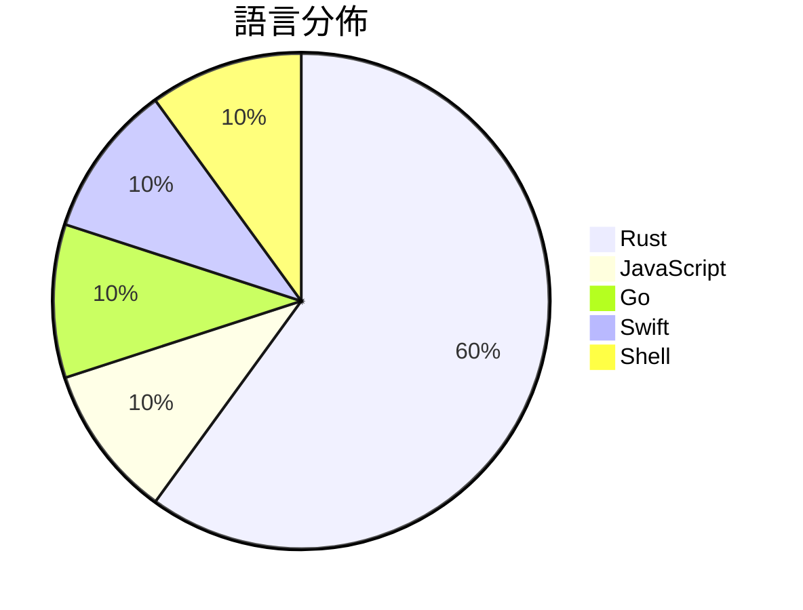

# GitHub Trending - 2026-10-14

> [!summary] 本日摘要
> 收錄 **10** 個新專案，合計 **46.7k** stars
> 語言分佈：Rust (6) · JavaScript (1) · Go (1) · Swift (1) · Shell (1)

> [!tip] 本週焦點
> **[[storytold--wordcraft|storytold/wordcraft]]** — 6 天內累積 11.4k stars（1.9k stars/天）
> An open-source, clean-room reimplementation of Microsoft Word in pure Rust



---

## 收錄列表

| # | 專案 | 分類 | Stars | 速度 | 安裝 | 語言 | 用途 |
| :--: | --- | --- | ---: | ---: | --- | --- | --- |
| 1 | [[storytold--wordcraft\|storytold/wordcraft]] |  | 11.4k | 1.9k/天 |  | Rust | An open-source, clean-room reimplementat |
| 2 | [[wheresryan22--anatomy\|wheresryan22/anatomy]] |  | 8.6k | 1.7k/天 |  | JavaScript | An agent skill for creating detailed, in |
| 3 | [[storytold--gridcraft\|storytold/gridcraft]] |  | 4.5k | 646/天 |  | Rust | GridCraft: an open-source, clean-room sp |
| 4 | [[storytold--cadcraft\|storytold/cadcraft]] |  | 4.3k | 619/天 |  | Rust | CADCraft: computer-aided design and draf |
| 5 | [[mhtsec--ARTEX\|mhtsec/ARTEX]] |  | 3.9k | 657/天 |  | Go | AI 自主渗透测试系统 | 百度“agent+”攻防挑战赛冠军项目 |
| 6 | [[storytold--deckcraft\|storytold/deckcraft]] |  | 3.0k | 431/天 |  | Rust | Presentations and slide shows: an open-s |
| 7 | [[nullmoth--nvidia-macos-driver\|nullmoth/nvidia-macos-driver]] |  | 2.9k | 487/天 |  | Rust | Metal driver for NVIDIA GeForce cards on |
| 8 | [[ARahim3--DigUp\|ARahim3/DigUp]] |  | 2.7k | 544/天 |  | Swift | Search your Mac by what's in your files: |
| 9 | [[storytold--soundcraft\|storytold/soundcraft]] |  | 2.6k | 437/天 |  | Rust | An open-source, clean-room reimplementat |
| 10 | [[t4t5--omdrop-owl\|t4t5/omdrop-owl]] |  | 2.6k | 521/天 |  | Shell | airdrop for non-apple devices |

---

## 重點摘要

### 1. [[storytold--wordcraft|storytold/wordcraft]]

**11.4k** stars · **1.9k** stars/天 · Rust

---

### 2. [[wheresryan22--anatomy|wheresryan22/anatomy]]

**8.6k** stars · **1.7k** stars/天 · JavaScript

---

### 3. [[storytold--gridcraft|storytold/gridcraft]]

**4.5k** stars · **646** stars/天 · Rust

---

### 4. [[storytold--cadcraft|storytold/cadcraft]]

**4.3k** stars · **619** stars/天 · Rust

---

### 5. [[mhtsec--ARTEX|mhtsec/ARTEX]]

**3.9k** stars · **657** stars/天 · Go

---

### 6. [[storytold--deckcraft|storytold/deckcraft]]

**3.0k** stars · **431** stars/天 · Rust

---

### 7. [[nullmoth--nvidia-macos-driver|nullmoth/nvidia-macos-driver]]

**2.9k** stars · **487** stars/天 · Rust

---

### 8. [[ARahim3--DigUp|ARahim3/DigUp]]

**2.7k** stars · **544** stars/天 · Swift

---

### 9. [[storytold--soundcraft|storytold/soundcraft]]

**2.6k** stars · **437** stars/天 · Rust

---

### 10. [[t4t5--omdrop-owl|t4t5/omdrop-owl]]

**2.6k** stars · **521** stars/天 · Shell

---

## 今日到期複習

> [!tip] 根據間隔複習排程，今天該回顧的專案

```dataview
TABLE
  stars_per_day AS "Stars/天",
  category AS "分類",
  engagement AS "參與度"
FROM "Repos"
WHERE next_review AND date(next_review) <= date("2026-10-14") AND status != "archived"
SORT priority DESC
```

## 待處理

```dataviewjs
const pending = dv.pages('"Repos"').where(p => p.status === "to-review").length;
const unrated = dv.pages('"Repos"').where(p => p.status !== "archived" && p.status !== "to-review" && (p.my_rating || 0) === 0).length;
const noVerdict = dv.pages('"Repos"').where(p => p.status !== "archived" && (p.my_rating || 0) > 0 && (!p.verdict || p.verdict === "")).length;
const items = [];
if (pending > 0) items.push(`**${pending}** 個待分流`);
if (unrated > 0) items.push(`**${unrated}** 個已讀但未評分`);
if (noVerdict > 0) items.push(`**${noVerdict}** 個已評分但無結論`);
if (items.length > 0) dv.paragraph(items.join(" / "));
else dv.paragraph("所有專案都已處理完畢！");
```
