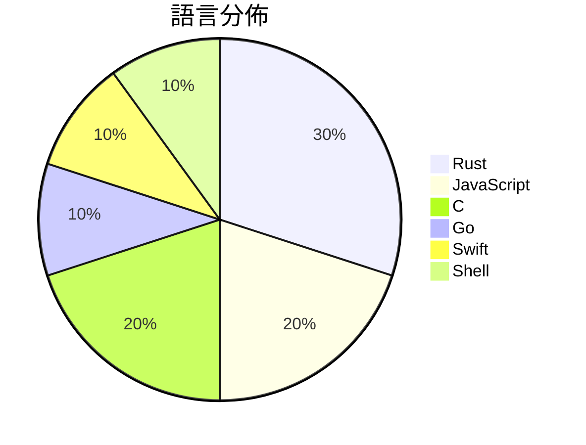

# GitHub Trending - 2026-10-15

> [!summary] 本日摘要
> 收錄 **10** 個新專案，合計 **35.0k** stars
> 語言分佈：Rust (3) · JavaScript (2) · C (2) · Go (1) · Swift (1) · Shell (1)

> [!tip] 本週焦點
> **[[wheresryan22--anatomy|wheresryan22/anatomy]]** — 6 天內累積 11.0k stars（1.8k stars/天）
> An agent skill for creating detailed, interactive isometric illustrations of real-world machines and complex systems. Generates polished SVGs with optional WebGL shaders and 3D effects.



---

## 收錄列表

| # | 專案 | 分類 | Stars | 速度 | 安裝 | 語言 | 用途 |
| :--: | --- | --- | ---: | ---: | --- | --- | --- |
| 1 | [[wheresryan22--anatomy\|wheresryan22/anatomy]] |  | 11.0k | 1.8k/天 |  | JavaScript | An agent skill for creating detailed, in |
| 2 | [[mhtsec--ARTEX\|mhtsec/ARTEX]] |  | 4.1k | 690/天 |  | Go | AI 自主渗透测试系统 | 百度“agent+”攻防挑战赛冠军项目 |
| 3 | [[ARahim3--DigUp\|ARahim3/DigUp]] |  | 3.8k | 628/天 |  | Swift | Search your computer by what's in your f |
| 4 | [[storytold--craft-launcher\|storytold/craft-launcher]] |  | 2.7k | 540/天 |  | Rust | The Craft App Launcher |
| 5 | [[t4t5--omdrop-owl\|t4t5/omdrop-owl]] |  | 2.7k | 449/天 |  | Shell | airdrop for non-apple devices |
| 6 | [[jhaizhou-ops--d2r-mobile\|jhaizhou-ops/d2r-mobile]] |  | 2.4k | 1.2k/天 |  | C | Open-source iOS / macOS compatibility la |
| 7 | [[liseami--CCBaga\|liseami/CCBaga]] |  | 2.3k | 571/天 |  | Rust |  |
| 8 | [[onehumanbeing--esp32-iphone-agent\|onehumanbeing/esp32-iphone-agent]] |  | 2.2k | 719/天 |  | C | Let an AI model use a real iPhone with a |
| 9 | [[noahdunnagan--fsearch\|noahdunnagan/fsearch]] |  | 2.1k | 344/天 |  | Rust | Whole-disk file search for macOS: fuzzy  |
| 10 | [[T-Auto--dsh-ops\|T-Auto/dsh-ops]] |  | 1.8k | 303/天 |  | JavaScript | A toolkit for low-level operations in DS |

---

## 重點摘要

### 1. [[wheresryan22--anatomy|wheresryan22/anatomy]]

**11.0k** stars · **1.8k** stars/天 · JavaScript

---

### 2. [[mhtsec--ARTEX|mhtsec/ARTEX]]

**4.1k** stars · **690** stars/天 · Go

---

### 3. [[ARahim3--DigUp|ARahim3/DigUp]]

**3.8k** stars · **628** stars/天 · Swift

---

### 4. [[storytold--craft-launcher|storytold/craft-launcher]]

**2.7k** stars · **540** stars/天 · Rust

---

### 5. [[t4t5--omdrop-owl|t4t5/omdrop-owl]]

**2.7k** stars · **449** stars/天 · Shell

---

### 6. [[jhaizhou-ops--d2r-mobile|jhaizhou-ops/d2r-mobile]]

**2.4k** stars · **1.2k** stars/天 · C

---

### 7. [[liseami--CCBaga|liseami/CCBaga]]

**2.3k** stars · **571** stars/天 · Rust

---

### 8. [[onehumanbeing--esp32-iphone-agent|onehumanbeing/esp32-iphone-agent]]

**2.2k** stars · **719** stars/天 · C

---

### 9. [[noahdunnagan--fsearch|noahdunnagan/fsearch]]

**2.1k** stars · **344** stars/天 · Rust

---

### 10. [[T-Auto--dsh-ops|T-Auto/dsh-ops]]

**1.8k** stars · **303** stars/天 · JavaScript

---

## 今日到期複習

> [!tip] 根據間隔複習排程，今天該回顧的專案

```dataview
TABLE
  stars_per_day AS "Stars/天",
  category AS "分類",
  engagement AS "參與度"
FROM "Repos"
WHERE next_review AND date(next_review) <= date("2026-10-15") AND status != "archived"
SORT priority DESC
```

## 待處理

```dataviewjs
const pending = dv.pages('"Repos"').where(p => p.status === "to-review").length;
const unrated = dv.pages('"Repos"').where(p => p.status !== "archived" && p.status !== "to-review" && (p.my_rating || 0) === 0).length;
const noVerdict = dv.pages('"Repos"').where(p => p.status !== "archived" && (p.my_rating || 0) > 0 && (!p.verdict || p.verdict === "")).length;
const items = [];
if (pending > 0) items.push(`**${pending}** 個待分流`);
if (unrated > 0) items.push(`**${unrated}** 個已讀但未評分`);
if (noVerdict > 0) items.push(`**${noVerdict}** 個已評分但無結論`);
if (items.length > 0) dv.paragraph(items.join(" / "));
else dv.paragraph("所有專案都已處理完畢！");
```
