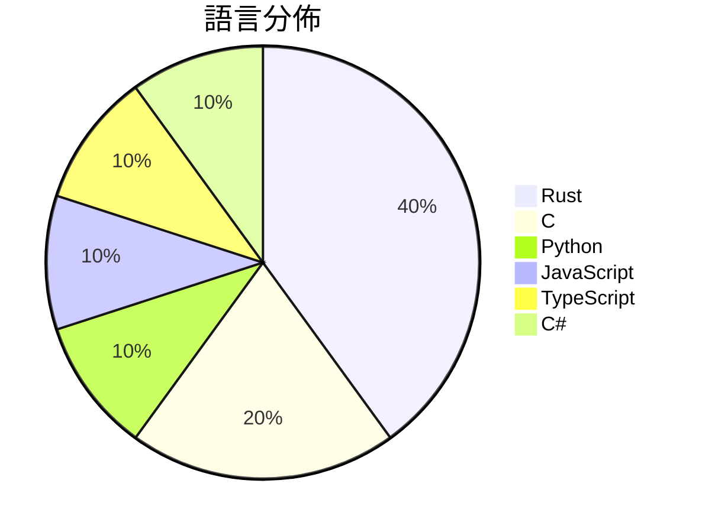

# GitHub Trending - 2026-10-16

> [!summary] 本日摘要
> 收錄 **10** 個新專案，合計 **20.0k** stars
> 語言分佈：Rust (4) · C (2) · Python (1) · JavaScript (1) · TypeScript (1) · C# (1)

> [!tip] 本週焦點
> **[[jhaizhou-ops--d2r-mobile|jhaizhou-ops/d2r-mobile]]** — 3 天內累積 3.3k stars（1.1k stars/天）
> Open-source iOS / macOS compatibility layer for Diablo II: Resurrected with the Reign of the Warlock expansion. Runs your own Switch copy natively on iPhone, iPad and Mac — full touch controls, 60 fps, new endgame modes. Bring your own game files. 开源的《暗黑破坏神 II：狱火重生》术士君临 iOS / macOS 兼容层



---

## 收錄列表

| # | 專案 | 分類 | Stars | 速度 | 安裝 | 語言 | 用途 |
| :--: | --- | --- | ---: | ---: | --- | --- | --- |
| 1 | [[jhaizhou-ops--d2r-mobile\|jhaizhou-ops/d2r-mobile]] |  | 3.3k | 1.1k/天 |  | C | Open-source iOS / macOS compatibility la |
| 2 | [[storytold--craft-launcher\|storytold/craft-launcher]] |  | 2.9k | 484/天 |  | Rust | The Craft App Launcher |
| 3 | [[onehumanbeing--esp32-iphone-agent\|onehumanbeing/esp32-iphone-agent]] |  | 2.6k | 650/天 |  | C | Let an AI model use a real iPhone with a |
| 4 | [[liseami--CCBaga\|liseami/CCBaga]] |  | 2.4k | 471/天 |  | Rust |  |
| 5 | [[Arekejoker--qwen21-nsfw-pose-skill\|Arekejoker/qwen21-nsfw-pose-skill]] |  | 2.1k | 717/天 |  | Python | Qwen-Image 2.1 NSFW/姿势出图 skill：作者级提示词配方  |
| 6 | [[storytold--figcraft\|storytold/figcraft]] |  | 1.5k | 244/天 |  | Rust | FigCraft: interface design and prototypi |
| 7 | [[HeyPuter--everything\|HeyPuter/everything]] |  | 1.4k | 694/天 |  | JavaScript | We're rebuilding and open-sourcing the w |
| 8 | [[shaongitbd--doory\|shaongitbd/doory]] |  | 1.3k | 224/天 |  | TypeScript | Open source canva alternative |
| 9 | [[ahwootech--BRUTAL\|ahwootech/BRUTAL]] |  | 1.3k | 1.3k/天 |  | C# | A free, open source C# framework for mak |
| 10 | [[opengeos--RustGIS\|opengeos/RustGIS]] |  | 1.2k | 247/天 |  | Rust | A fast, free and open-source GIS in pure |

---

## 重點摘要

### 1. [[jhaizhou-ops--d2r-mobile|jhaizhou-ops/d2r-mobile]]

**3.3k** stars · **1.1k** stars/天 · C

---

### 2. [[storytold--craft-launcher|storytold/craft-launcher]]

**2.9k** stars · **484** stars/天 · Rust

---

### 3. [[onehumanbeing--esp32-iphone-agent|onehumanbeing/esp32-iphone-agent]]

**2.6k** stars · **650** stars/天 · C

---

### 4. [[liseami--CCBaga|liseami/CCBaga]]

**2.4k** stars · **471** stars/天 · Rust

---

### 5. [[Arekejoker--qwen21-nsfw-pose-skill|Arekejoker/qwen21-nsfw-pose-skill]]

**2.1k** stars · **717** stars/天 · Python

---

### 6. [[storytold--figcraft|storytold/figcraft]]

**1.5k** stars · **244** stars/天 · Rust

---

### 7. [[HeyPuter--everything|HeyPuter/everything]]

**1.4k** stars · **694** stars/天 · JavaScript

---

### 8. [[shaongitbd--doory|shaongitbd/doory]]

**1.3k** stars · **224** stars/天 · TypeScript

---

### 9. [[ahwootech--BRUTAL|ahwootech/BRUTAL]]

**1.3k** stars · **1.3k** stars/天 · C#

---

### 10. [[opengeos--RustGIS|opengeos/RustGIS]]

**1.2k** stars · **247** stars/天 · Rust

---

## 今日到期複習

> [!tip] 根據間隔複習排程，今天該回顧的專案

```dataview
TABLE
  stars_per_day AS "Stars/天",
  category AS "分類",
  engagement AS "參與度"
FROM "Repos"
WHERE next_review AND date(next_review) <= date("2026-10-16") AND status != "archived"
SORT priority DESC
```

## 待處理

```dataviewjs
const pending = dv.pages('"Repos"').where(p => p.status === "to-review").length;
const unrated = dv.pages('"Repos"').where(p => p.status !== "archived" && p.status !== "to-review" && (p.my_rating || 0) === 0).length;
const noVerdict = dv.pages('"Repos"').where(p => p.status !== "archived" && (p.my_rating || 0) > 0 && (!p.verdict || p.verdict === "")).length;
const items = [];
if (pending > 0) items.push(`**${pending}** 個待分流`);
if (unrated > 0) items.push(`**${unrated}** 個已讀但未評分`);
if (noVerdict > 0) items.push(`**${noVerdict}** 個已評分但無結論`);
if (items.length > 0) dv.paragraph(items.join(" / "));
else dv.paragraph("所有專案都已處理完畢！");
```
