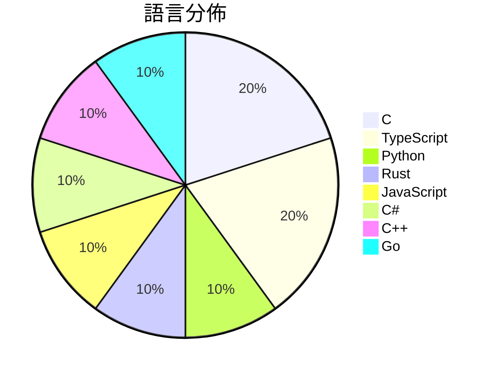

# GitHub Trending - 2026-10-18

> [!summary] 本日摘要
> 收錄 **10** 個新專案，合計 **21.9k** stars
> 語言分佈：C (2) · TypeScript (2) · Python (1) · Rust (1) · JavaScript (1) · C# (1) · C++ (1) · Go (1)

> [!tip] 本週焦點
> **[[jhaizhou-ops--d2r-mobile|jhaizhou-ops/d2r-mobile]]** — 5 天內累積 3.7k stars（748 stars/天）
> Open-source iOS / macOS compatibility layer for Diablo II: Resurrected with the Reign of the Warlock expansion. Runs your own Switch copy natively on iPhone, iPad and Mac — full touch controls, 60 fps, new endgame modes. Bring your own game files. 开源的《暗黑破坏神 II：狱火重生》术士君临 iOS / macOS 兼容层



---

## 收錄列表

| # | 專案 | 分類 | Stars | 速度 | 安裝 | 語言 | 用途 |
| :--: | --- | --- | ---: | ---: | --- | --- | --- |
| 1 | [[jhaizhou-ops--d2r-mobile\|jhaizhou-ops/d2r-mobile]] |  | 3.7k | 748/天 |  | C | Open-source iOS / macOS compatibility la |
| 2 | [[onehumanbeing--esp32-iphone-agent\|onehumanbeing/esp32-iphone-agent]] |  | 3.0k | 503/天 |  | C | Let an AI model use a real iPhone with a |
| 3 | [[Arekejoker--qwen21-nsfw-pose-skill\|Arekejoker/qwen21-nsfw-pose-skill]] |  | 2.7k | 532/天 |  | Python | Qwen-Image 2.1 NSFW/姿势出图 skill：作者级提示词配方  |
| 4 | [[liseami--CCBaga\|liseami/CCBaga]] |  | 2.6k | 371/天 |  | Rust |  |
| 5 | [[HeyPuter--everything\|HeyPuter/everything]] |  | 2.1k | 521/天 |  | JavaScript | We're rebuilding and open-sourcing the w |
| 6 | [[deeplethe--solid-glass\|deeplethe/solid-glass]] |  | 1.8k | 365/天 |  | TypeScript | A design system for AI applications. Mat |
| 7 | [[ahwootech--BRUTAL\|ahwootech/BRUTAL]] |  | 1.8k | 604/天 |  | C# | A free, open source C# framework for mak |
| 8 | [[chenglou--handwired\|chenglou/handwired]] |  | 1.7k | 562/天 |  | TypeScript | Turn your regular JavaScript code into a |
| 9 | [[Supermedo--uncharted_pc\|Supermedo/uncharted_pc]] |  | 1.3k | 430/天 |  | C++ | Uncharted: The Nathan Drake Collection r |
| 10 | [[feder-cr--git-ai\|feder-cr/git-ai]] |  | 1.1k | 574/天 |  | Go | Git designed for AI agents. |

---

## 重點摘要

### 1. [[jhaizhou-ops--d2r-mobile|jhaizhou-ops/d2r-mobile]]

**3.7k** stars · **748** stars/天 · C

---

### 2. [[onehumanbeing--esp32-iphone-agent|onehumanbeing/esp32-iphone-agent]]

**3.0k** stars · **503** stars/天 · C

---

### 3. [[Arekejoker--qwen21-nsfw-pose-skill|Arekejoker/qwen21-nsfw-pose-skill]]

**2.7k** stars · **532** stars/天 · Python

---

### 4. [[liseami--CCBaga|liseami/CCBaga]]

**2.6k** stars · **371** stars/天 · Rust

---

### 5. [[HeyPuter--everything|HeyPuter/everything]]

**2.1k** stars · **521** stars/天 · JavaScript

---

### 6. [[deeplethe--solid-glass|deeplethe/solid-glass]]

**1.8k** stars · **365** stars/天 · TypeScript

---

### 7. [[ahwootech--BRUTAL|ahwootech/BRUTAL]]

**1.8k** stars · **604** stars/天 · C#

---

### 8. [[chenglou--handwired|chenglou/handwired]]

**1.7k** stars · **562** stars/天 · TypeScript

---

### 9. [[Supermedo--uncharted_pc|Supermedo/uncharted_pc]]

**1.3k** stars · **430** stars/天 · C++

---

### 10. [[feder-cr--git-ai|feder-cr/git-ai]]

**1.1k** stars · **574** stars/天 · Go

---

## 今日到期複習

> [!tip] 根據間隔複習排程，今天該回顧的專案

```dataview
TABLE
  stars_per_day AS "Stars/天",
  category AS "分類",
  engagement AS "參與度"
FROM "Repos"
WHERE next_review AND date(next_review) <= date("2026-10-18") AND status != "archived"
SORT priority DESC
```

## 待處理

```dataviewjs
const pending = dv.pages('"Repos"').where(p => p.status === "to-review").length;
const unrated = dv.pages('"Repos"').where(p => p.status !== "archived" && p.status !== "to-review" && (p.my_rating || 0) === 0).length;
const noVerdict = dv.pages('"Repos"').where(p => p.status !== "archived" && (p.my_rating || 0) > 0 && (!p.verdict || p.verdict === "")).length;
const items = [];
if (pending > 0) items.push(`**${pending}** 個待分流`);
if (unrated > 0) items.push(`**${unrated}** 個已讀但未評分`);
if (noVerdict > 0) items.push(`**${noVerdict}** 個已評分但無結論`);
if (items.length > 0) dv.paragraph(items.join(" / "));
else dv.paragraph("所有專案都已處理完畢！");
```
