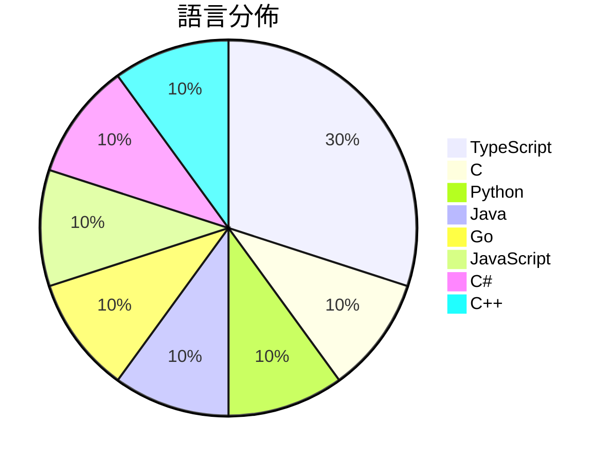

# GitHub Trending - 2026-10-19

> [!summary] 本日摘要
> 收錄 **10** 個新專案，合計 **22.5k** stars
> 語言分佈：TypeScript (3) · C (1) · Python (1) · Java (1) · Go (1) · JavaScript (1) · C# (1) · C++ (1)

> [!tip] 本週焦點
> **[[jhaizhou-ops--d2r-mobile|jhaizhou-ops/d2r-mobile]]** — 6 天內累積 3.9k stars（655 stars/天）
> Open-source iOS / macOS compatibility layer for Diablo II: Resurrected with the Reign of the Warlock expansion. Runs your own Switch copy natively on iPhone, iPad and Mac — full touch controls, 60 fps, new endgame modes. Bring your own game files. 开源的《暗黑破坏神 II：狱火重生》术士君临 iOS / macOS 兼容层



---

## 收錄列表

| # | 專案 | 分類 | Stars | 速度 | 安裝 | 語言 | 用途 |
| :--: | --- | --- | ---: | ---: | --- | --- | --- |
| 1 | [[jhaizhou-ops--d2r-mobile\|jhaizhou-ops/d2r-mobile]] |  | 3.9k | 655/天 |  | C | Open-source iOS / macOS compatibility la |
| 2 | [[Arekejoker--qwen21-nsfw-pose-skill\|Arekejoker/qwen21-nsfw-pose-skill]] |  | 3.1k | 511/天 |  | Python | Qwen-Image 2.1 NSFW/姿势出图 skill：作者级提示词配方  |
| 3 | [[Gathin23--tv-vibehack\|Gathin23/tv-vibehack]] |  | 2.5k | 2.5k/天 |  | Java | Your TV, minus the ads. Debloat any Andr |
| 4 | [[feder-cr--git-ai\|feder-cr/git-ai]] |  | 2.3k | 773/天 |  | Go | Git designed for AI agents. |
| 5 | [[HeyPuter--everything\|HeyPuter/everything]] |  | 2.2k | 448/天 |  | JavaScript | We're rebuilding and open-sourcing the w |
| 6 | [[deeplethe--solid-glass\|deeplethe/solid-glass]] |  | 2.2k | 360/天 |  | TypeScript | A design system for AI applications. Mat |
| 7 | [[ahwootech--BRUTAL\|ahwootech/BRUTAL]] |  | 1.9k | 481/天 |  | C# | A free, open source C# framework for mak |
| 8 | [[chenglou--handwired\|chenglou/handwired]] |  | 1.7k | 436/天 |  | TypeScript | Turn your regular JavaScript code into a |
| 9 | [[Supermedo--uncharted_pc\|Supermedo/uncharted_pc]] |  | 1.5k | 368/天 |  | C++ | Uncharted: The Nathan Drake Collection r |
| 10 | [[Caho1--open-claude-ui\|Caho1/open-claude-ui]] |  | 1.2k | 304/天 |  | TypeScript | 基于 REA 深度拆解并高保真还原 Claude 官方桌面端 UI。还原 30  |

---

## 重點摘要

### 1. [[jhaizhou-ops--d2r-mobile|jhaizhou-ops/d2r-mobile]]

**3.9k** stars · **655** stars/天 · C

---

### 2. [[Arekejoker--qwen21-nsfw-pose-skill|Arekejoker/qwen21-nsfw-pose-skill]]

**3.1k** stars · **511** stars/天 · Python

---

### 3. [[Gathin23--tv-vibehack|Gathin23/tv-vibehack]]

**2.5k** stars · **2.5k** stars/天 · Java

---

### 4. [[feder-cr--git-ai|feder-cr/git-ai]]

**2.3k** stars · **773** stars/天 · Go

---

### 5. [[HeyPuter--everything|HeyPuter/everything]]

**2.2k** stars · **448** stars/天 · JavaScript

---

### 6. [[deeplethe--solid-glass|deeplethe/solid-glass]]

**2.2k** stars · **360** stars/天 · TypeScript

---

### 7. [[ahwootech--BRUTAL|ahwootech/BRUTAL]]

**1.9k** stars · **481** stars/天 · C#

---

### 8. [[chenglou--handwired|chenglou/handwired]]

**1.7k** stars · **436** stars/天 · TypeScript

---

### 9. [[Supermedo--uncharted_pc|Supermedo/uncharted_pc]]

**1.5k** stars · **368** stars/天 · C++

---

### 10. [[Caho1--open-claude-ui|Caho1/open-claude-ui]]

**1.2k** stars · **304** stars/天 · TypeScript

---

## 今日到期複習

> [!tip] 根據間隔複習排程，今天該回顧的專案

```dataview
TABLE
  stars_per_day AS "Stars/天",
  category AS "分類",
  engagement AS "參與度"
FROM "Repos"
WHERE next_review AND date(next_review) <= date("2026-10-19") AND status != "archived"
SORT priority DESC
```

## 待處理

```dataviewjs
const pending = dv.pages('"Repos"').where(p => p.status === "to-review").length;
const unrated = dv.pages('"Repos"').where(p => p.status !== "archived" && p.status !== "to-review" && (p.my_rating || 0) === 0).length;
const noVerdict = dv.pages('"Repos"').where(p => p.status !== "archived" && (p.my_rating || 0) > 0 && (!p.verdict || p.verdict === "")).length;
const items = [];
if (pending > 0) items.push(`**${pending}** 個待分流`);
if (unrated > 0) items.push(`**${unrated}** 個已讀但未評分`);
if (noVerdict > 0) items.push(`**${noVerdict}** 個已評分但無結論`);
if (items.length > 0) dv.paragraph(items.join(" / "));
else dv.paragraph("所有專案都已處理完畢！");
```
