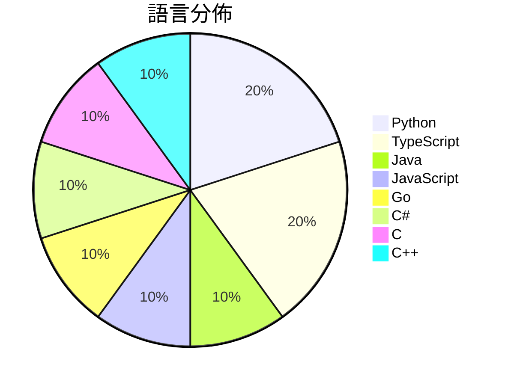

# GitHub Trending - 2026-10-20

> [!summary] 本日摘要
> 收錄 **10** 個新專案，合計 **25.5k** stars
> 語言分佈：Python (2) · TypeScript (2) · Java (1) · JavaScript (1) · Go (1) · C# (1) · C (1) · C++ (1)

> [!tip] 本週焦點
> **[[Gathin23--cleanyourtv|Gathin23/cleanyourtv]]** — 2 天內累積 6.6k stars（3.3k stars/天）
> Debloat any Android or Google TV over Wi-Fi and get an Apple TV-style home.



---

## 收錄列表

| # | 專案 | 分類 | Stars | 速度 | 安裝 | 語言 | 用途 |
| :--: | --- | --- | ---: | ---: | --- | --- | --- |
| 1 | [[Gathin23--cleanyourtv\|Gathin23/cleanyourtv]] |  | 6.6k | 3.3k/天 |  | Java | Debloat any Android or Google TV over Wi |
| 2 | [[Arekejoker--qwen21-nsfw-pose-skill\|Arekejoker/qwen21-nsfw-pose-skill]] |  | 3.4k | 488/天 |  | Python | Qwen-Image 2.1 NSFW/姿势出图 skill：作者级提示词配方  |
| 3 | [[HeyPuter--everything\|HeyPuter/everything]] |  | 2.7k | 442/天 |  | JavaScript | We're rebuilding and open-sourcing the w |
| 4 | [[feder-cr--git-ai\|feder-cr/git-ai]] |  | 2.5k | 618/天 |  | Go | Git designed for AI agents. |
| 5 | [[ahwootech--BRUTAL\|ahwootech/BRUTAL]] |  | 2.0k | 400/天 |  | C# | A free, open source C# framework for mak |
| 6 | [[ly05010419--MacNativeGames\|ly05010419/MacNativeGames]] |  | 2.0k | 1.0k/天 |  | C |  |
| 7 | [[chenglou--handwired\|chenglou/handwired]] |  | 1.8k | 365/天 |  | TypeScript | Turn your regular JavaScript code into a |
| 8 | [[Leonxlnx--earshot\|Leonxlnx/earshot]] |  | 1.6k | 409/天 |  | Python | Ears for coding agents: let AI hear, rev |
| 9 | [[Supermedo--uncharted_pc\|Supermedo/uncharted_pc]] |  | 1.6k | 323/天 |  | C++ | Uncharted: The Nathan Drake Collection r |
| 10 | [[Caho1--open-claude-ui\|Caho1/open-claude-ui]] |  | 1.3k | 252/天 |  | TypeScript | 基于 REA 深度拆解并高保真还原 Claude 官方桌面端 UI。还原 30  |

---

## 重點摘要

### 1. [[Gathin23--cleanyourtv|Gathin23/cleanyourtv]]

**6.6k** stars · **3.3k** stars/天 · Java

---

### 2. [[Arekejoker--qwen21-nsfw-pose-skill|Arekejoker/qwen21-nsfw-pose-skill]]

**3.4k** stars · **488** stars/天 · Python

---

### 3. [[HeyPuter--everything|HeyPuter/everything]]

**2.7k** stars · **442** stars/天 · JavaScript

---

### 4. [[feder-cr--git-ai|feder-cr/git-ai]]

**2.5k** stars · **618** stars/天 · Go

---

### 5. [[ahwootech--BRUTAL|ahwootech/BRUTAL]]

**2.0k** stars · **400** stars/天 · C#

---

### 6. [[ly05010419--MacNativeGames|ly05010419/MacNativeGames]]

**2.0k** stars · **1.0k** stars/天 · C

---

### 7. [[chenglou--handwired|chenglou/handwired]]

**1.8k** stars · **365** stars/天 · TypeScript

---

### 8. [[Leonxlnx--earshot|Leonxlnx/earshot]]

**1.6k** stars · **409** stars/天 · Python

---

### 9. [[Supermedo--uncharted_pc|Supermedo/uncharted_pc]]

**1.6k** stars · **323** stars/天 · C++

---

### 10. [[Caho1--open-claude-ui|Caho1/open-claude-ui]]

**1.3k** stars · **252** stars/天 · TypeScript

---

## 今日到期複習

> [!tip] 根據間隔複習排程，今天該回顧的專案

```dataview
TABLE
  stars_per_day AS "Stars/天",
  category AS "分類",
  engagement AS "參與度"
FROM "Repos"
WHERE next_review AND date(next_review) <= date("2026-10-20") AND status != "archived"
SORT priority DESC
```

## 待處理

```dataviewjs
const pending = dv.pages('"Repos"').where(p => p.status === "to-review").length;
const unrated = dv.pages('"Repos"').where(p => p.status !== "archived" && p.status !== "to-review" && (p.my_rating || 0) === 0).length;
const noVerdict = dv.pages('"Repos"').where(p => p.status !== "archived" && (p.my_rating || 0) > 0 && (!p.verdict || p.verdict === "")).length;
const items = [];
if (pending > 0) items.push(`**${pending}** 個待分流`);
if (unrated > 0) items.push(`**${unrated}** 個已讀但未評分`);
if (noVerdict > 0) items.push(`**${noVerdict}** 個已評分但無結論`);
if (items.length > 0) dv.paragraph(items.join(" / "));
else dv.paragraph("所有專案都已處理完畢！");
```
