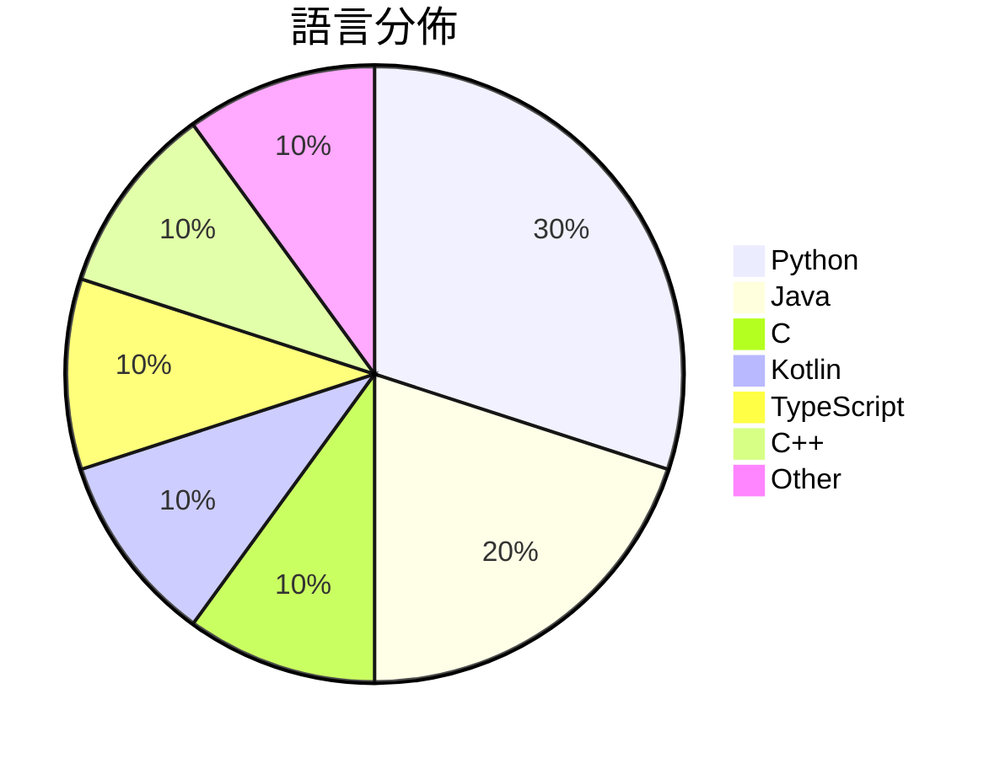

# GitHub Trending - 2026-10-22

> [!summary] 本日摘要
> 收錄 **10** 個新專案，合計 **57.4k** stars
> 語言分佈：Python (3) · Java (2) · C (1) · Kotlin (1) · TypeScript (1) · C++ (1) · Other (1)

> [!tip] 本週焦點
> **[[Gathin23--cleanyourtv|Gathin23/cleanyourtv]]** — 4 天內累積 20.4k stars（5.1k stars/天）
> Debloat any Android or Google TV over Wi-Fi and get an Apple TV-style home.



---

## 收錄列表

| # | 專案 | 分類 | Stars | 速度 | 安裝 | 語言 | 用途 |
| :--: | --- | --- | ---: | ---: | --- | --- | --- |
| 1 | [[Gathin23--cleanyourtv\|Gathin23/cleanyourtv]] |  | 20.4k | 5.1k/天 |  | Java | Debloat any Android or Google TV over Wi |
| 2 | [[deepseek-ai--DeepInfer\|deepseek-ai/DeepInfer]] |  | 18.5k | 3.7k/天 |  | Python | DeepInfer: High-performance, large-scale |
| 3 | [[ly05010419--MacNativeGames\|ly05010419/MacNativeGames]] |  | 4.1k | 1.0k/天 |  | C |  |
| 4 | [[simbasjungles--free-my-tv\|simbasjungles/free-my-tv]] |  | 2.8k | 1.4k/天 |  | Java | A fast, ad-free home screen for Google T |
| 5 | [[pengchujin--aerial-tv\|pengchujin/aerial-tv]] |  | 2.4k | 2.4k/天 |  | Kotlin | 给国产电视的一块干净桌面：参照 tvOS 设计的开源 Android TV 桌面 |
| 6 | [[Leonxlnx--earshot\|Leonxlnx/earshot]] |  | 2.1k | 344/天 |  | Python | Ears for coding agents: let AI hear, rev |
| 7 | [[xiaoyang111222--cn-math-taxonomy\|xiaoyang111222/cn-math-taxonomy]] |  | 2.1k | 687/天 |  | Python | 中小学知识图谱 + 前置诊断：数学（一–九年级、高中必修与选择性必修）+ 英语（ |
| 8 | [[chenglou--handwired\|chenglou/handwired]] |  | 1.9k | 268/天 |  | TypeScript | Turn your regular JavaScript code into a |
| 9 | [[Supermedo--uncharted_pc\|Supermedo/uncharted_pc]] |  | 1.8k | 257/天 |  | C++ | Uncharted: The Nathan Drake Collection r |
| 10 | [[JoasASantos--REA-Prompts\|JoasASantos/REA-Prompts]] |  | 1.4k | 687/天 |  | N/A | REAP - Prompts for you to use REA (Rever |

---

## 重點摘要

### 1. [[Gathin23--cleanyourtv|Gathin23/cleanyourtv]]

**20.4k** stars · **5.1k** stars/天 · Java

---

### 2. [[deepseek-ai--DeepInfer|deepseek-ai/DeepInfer]]

**18.5k** stars · **3.7k** stars/天 · Python

---

### 3. [[ly05010419--MacNativeGames|ly05010419/MacNativeGames]]

**4.1k** stars · **1.0k** stars/天 · C

---

### 4. [[simbasjungles--free-my-tv|simbasjungles/free-my-tv]]

**2.8k** stars · **1.4k** stars/天 · Java

---

### 5. [[pengchujin--aerial-tv|pengchujin/aerial-tv]]

**2.4k** stars · **2.4k** stars/天 · Kotlin

---

### 6. [[Leonxlnx--earshot|Leonxlnx/earshot]]

**2.1k** stars · **344** stars/天 · Python

---

### 7. [[xiaoyang111222--cn-math-taxonomy|xiaoyang111222/cn-math-taxonomy]]

**2.1k** stars · **687** stars/天 · Python

---

### 8. [[chenglou--handwired|chenglou/handwired]]

**1.9k** stars · **268** stars/天 · TypeScript

---

### 9. [[Supermedo--uncharted_pc|Supermedo/uncharted_pc]]

**1.8k** stars · **257** stars/天 · C++

---

### 10. [[JoasASantos--REA-Prompts|JoasASantos/REA-Prompts]]

**1.4k** stars · **687** stars/天 · N/A

---

## 今日到期複習

> [!tip] 根據間隔複習排程，今天該回顧的專案

```dataview
TABLE
  stars_per_day AS "Stars/天",
  category AS "分類",
  engagement AS "參與度"
FROM "Repos"
WHERE next_review AND date(next_review) <= date("2026-10-22") AND status != "archived"
SORT priority DESC
```

## 待處理

```dataviewjs
const pending = dv.pages('"Repos"').where(p => p.status === "to-review").length;
const unrated = dv.pages('"Repos"').where(p => p.status !== "archived" && p.status !== "to-review" && (p.my_rating || 0) === 0).length;
const noVerdict = dv.pages('"Repos"').where(p => p.status !== "archived" && (p.my_rating || 0) > 0 && (!p.verdict || p.verdict === "")).length;
const items = [];
if (pending > 0) items.push(`**${pending}** 個待分流`);
if (unrated > 0) items.push(`**${unrated}** 個已讀但未評分`);
if (noVerdict > 0) items.push(`**${noVerdict}** 個已評分但無結論`);
if (items.length > 0) dv.paragraph(items.join(" / "));
else dv.paragraph("所有專案都已處理完畢！");
```
