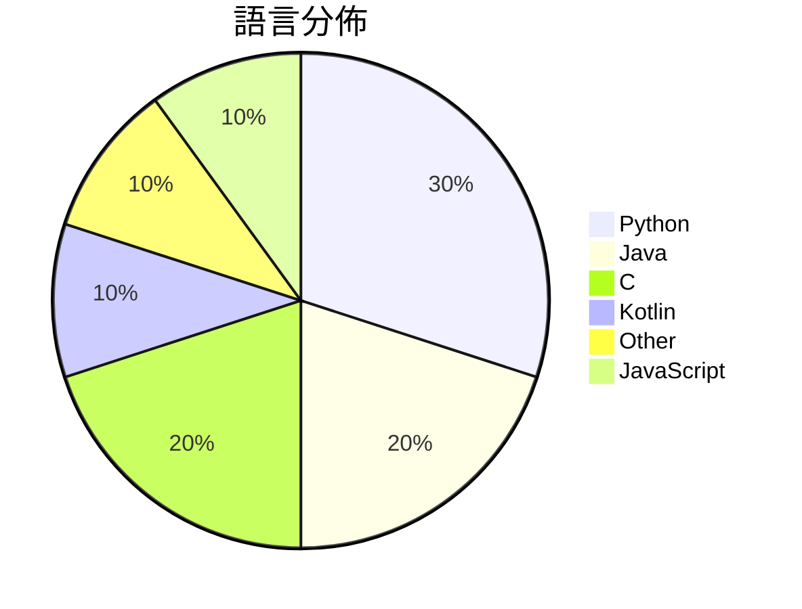

# GitHub Trending - 2026-10-24

> [!summary] 本日摘要
> 收錄 **10** 個新專案，合計 **53.0k** stars
> 語言分佈：Python (3) · Java (2) · C (2) · Kotlin (1) · Other (1) · JavaScript (1)

> [!tip] 本週焦點
> **[[Gathin23--cleanyourtv|Gathin23/cleanyourtv]]** — 6 天內累積 28.5k stars（4.8k stars/天）
> Debloat any Android or Google TV over Wi-Fi and get an Apple TV-style home.



---

## 收錄列表

| # | 專案 | 分類 | Stars | 速度 | 安裝 | 語言 | 用途 |
| :--: | --- | --- | ---: | ---: | --- | --- | --- |
| 1 | [[Gathin23--cleanyourtv\|Gathin23/cleanyourtv]] |  | 28.5k | 4.8k/天 |  | Java | Debloat any Android or Google TV over Wi |
| 2 | [[ly05010419--MacNativeGames\|ly05010419/MacNativeGames]] |  | 5.0k | 833/天 |  | C |  |
| 3 | [[simbasjungles--free-my-tv\|simbasjungles/free-my-tv]] |  | 4.0k | 1.0k/天 |  | Java | A fast, ad-free home screen for Google T |
| 4 | [[pengchujin--aerial-tv\|pengchujin/aerial-tv]] |  | 4.0k | 1.3k/天 |  | Kotlin | 给国产电视的一块干净桌面：参照 tvOS 设计的开源 Android TV 桌面 |
| 5 | [[xiaoyang111222--cn-math-taxonomy\|xiaoyang111222/cn-math-taxonomy]] |  | 2.9k | 578/天 |  | Python | 数学（小学到高中）、英语（三年级到高中）、初中物理的知识图谱：1644 个知识点 |
| 6 | [[aicodeking--leanrea\|aicodeking/leanrea]] |  | 1.9k | 267/天 |  | Python | One 8 KB skill that replaces REA (Revers |
| 7 | [[JoasASantos--REA-Prompts\|JoasASantos/REA-Prompts]] |  | 1.8k | 446/天 |  | N/A | REAP - Prompts for you to use REA (Rever |
| 8 | [[ikow--php2shell-poc\|ikow/php2shell-poc]] |  | 1.7k | 854/天 |  | Python | CVE-2026-109618/109619 — 5 RCE chains +  |
| 9 | [[EthanArbuckle--fairplay-decrypt\|EthanArbuckle/fairplay-decrypt]] |  | 1.7k | 420/天 |  | C | Offline FairPlay App Store IPA decryptio |
| 10 | [[alchaincyf--huashu-motion\|alchaincyf/huashu-motion]] |  | 1.6k | 310/天 |  | JavaScript | 让你的agent一键直出商业级产品宣传片：会作曲，能指着画面改。Commerci |

---

## 重點摘要

### 1. [[Gathin23--cleanyourtv|Gathin23/cleanyourtv]]

**28.5k** stars · **4.8k** stars/天 · Java

---

### 2. [[ly05010419--MacNativeGames|ly05010419/MacNativeGames]]

**5.0k** stars · **833** stars/天 · C

---

### 3. [[simbasjungles--free-my-tv|simbasjungles/free-my-tv]]

**4.0k** stars · **1.0k** stars/天 · Java

---

### 4. [[pengchujin--aerial-tv|pengchujin/aerial-tv]]

**4.0k** stars · **1.3k** stars/天 · Kotlin

---

### 5. [[xiaoyang111222--cn-math-taxonomy|xiaoyang111222/cn-math-taxonomy]]

**2.9k** stars · **578** stars/天 · Python

---

### 6. [[aicodeking--leanrea|aicodeking/leanrea]]

**1.9k** stars · **267** stars/天 · Python

---

### 7. [[JoasASantos--REA-Prompts|JoasASantos/REA-Prompts]]

**1.8k** stars · **446** stars/天 · N/A

---

### 8. [[ikow--php2shell-poc|ikow/php2shell-poc]]

**1.7k** stars · **854** stars/天 · Python

---

### 9. [[EthanArbuckle--fairplay-decrypt|EthanArbuckle/fairplay-decrypt]]

**1.7k** stars · **420** stars/天 · C

---

### 10. [[alchaincyf--huashu-motion|alchaincyf/huashu-motion]]

**1.6k** stars · **310** stars/天 · JavaScript

---

## 今日到期複習

> [!tip] 根據間隔複習排程，今天該回顧的專案

```dataview
TABLE
  stars_per_day AS "Stars/天",
  category AS "分類",
  engagement AS "參與度"
FROM "Repos"
WHERE next_review AND date(next_review) <= date("2026-10-24") AND status != "archived"
SORT priority DESC
```

## 待處理

```dataviewjs
const pending = dv.pages('"Repos"').where(p => p.status === "to-review").length;
const unrated = dv.pages('"Repos"').where(p => p.status !== "archived" && p.status !== "to-review" && (p.my_rating || 0) === 0).length;
const noVerdict = dv.pages('"Repos"').where(p => p.status !== "archived" && (p.my_rating || 0) > 0 && (!p.verdict || p.verdict === "")).length;
const items = [];
if (pending > 0) items.push(`**${pending}** 個待分流`);
if (unrated > 0) items.push(`**${unrated}** 個已讀但未評分`);
if (noVerdict > 0) items.push(`**${noVerdict}** 個已評分但無結論`);
if (items.length > 0) dv.paragraph(items.join(" / "));
else dv.paragraph("所有專案都已處理完畢！");
```
