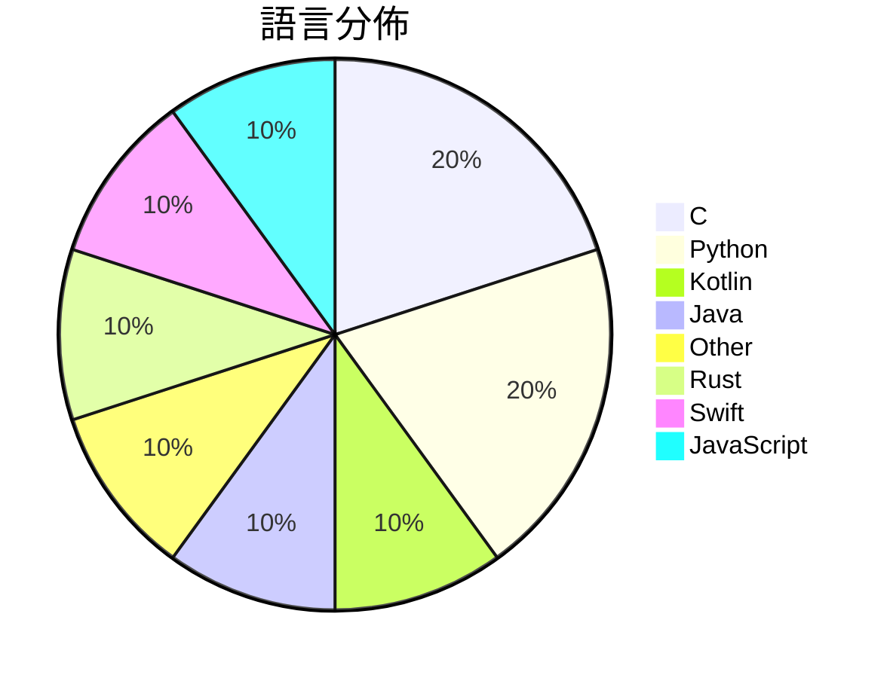

# GitHub Trending - 2026-10-25

> [!summary] 本日摘要
> 收錄 **10** 個新專案，合計 **26.8k** stars
> 語言分佈：C (2) · Python (2) · Kotlin (1) · Java (1) · Other (1) · Rust (1) · Swift (1) · JavaScript (1)

> [!tip] 本週焦點
> **[[pengchujin--aerial-tv|pengchujin/aerial-tv]]** — 4 天內累積 4.5k stars（1.1k stars/天）
> 给国产电视的一块干净桌面：参照 tvOS 设计的开源 Android TV 桌面，没有广告，开机自动接管。A tvOS-style launcher for Xiaomi, TCL and other China-market TVs.



---

## 收錄列表

| # | 專案 | 分類 | Stars | 速度 | 安裝 | 語言 | 用途 |
| :--: | --- | --- | ---: | ---: | --- | --- | --- |
| 1 | [[pengchujin--aerial-tv\|pengchujin/aerial-tv]] |  | 4.5k | 1.1k/天 |  | Kotlin | 给国产电视的一块干净桌面：参照 tvOS 设计的开源 Android TV 桌面 |
| 2 | [[simbasjungles--free-my-tv\|simbasjungles/free-my-tv]] |  | 4.3k | 870/天 |  | Java | A fast, ad-free home screen for Google T |
| 3 | [[Zagitta--gpu-unlock\|Zagitta/gpu-unlock]] |  | 3.5k | 507/天 |  | C | Unlock FP/BF16 instruction issue rate on |
| 4 | [[xiaoyang111222--cn-math-taxonomy\|xiaoyang111222/cn-math-taxonomy]] |  | 3.4k | 561/天 |  | Python | 数学（小学到高中）、英语（三年级到高中）、初中物理的知识图谱：1644 个知识点 |
| 5 | [[JoasASantos--REA-Prompts\|JoasASantos/REA-Prompts]] |  | 2.2k | 436/天 |  | N/A | REAP - Prompts for you to use REA (Rever |
| 6 | [[EthanArbuckle--fairplay-decrypt\|EthanArbuckle/fairplay-decrypt]] |  | 2.0k | 401/天 |  | C | Offline FairPlay App Store IPA decryptio |
| 7 | [[ikow--php2shell-poc\|ikow/php2shell-poc]] |  | 1.8k | 588/天 |  | Python | CVE-2026-109618/109619 — 5 RCE chains +  |
| 8 | [[xevrion--hatchzip\|xevrion/hatchzip]] |  | 1.8k | 586/天 |  | Rust | Extract huge archives in place: the arch |
| 9 | [[wesbos--3d-model-anything\|wesbos/3d-model-anything]] |  | 1.7k | 576/天 |  | Swift | Capture iPhone LiDAR and photos, reconst |
| 10 | [[alchaincyf--huashu-motion\|alchaincyf/huashu-motion]] |  | 1.6k | 268/天 |  | JavaScript | 让你的agent一键直出商业级产品宣传片：会作曲，能指着画面改。Commerci |

---

## 重點摘要

### 1. [[pengchujin--aerial-tv|pengchujin/aerial-tv]]

**4.5k** stars · **1.1k** stars/天 · Kotlin

---

### 2. [[simbasjungles--free-my-tv|simbasjungles/free-my-tv]]

**4.3k** stars · **870** stars/天 · Java

---

### 3. [[Zagitta--gpu-unlock|Zagitta/gpu-unlock]]

**3.5k** stars · **507** stars/天 · C

---

### 4. [[xiaoyang111222--cn-math-taxonomy|xiaoyang111222/cn-math-taxonomy]]

**3.4k** stars · **561** stars/天 · Python

---

### 5. [[JoasASantos--REA-Prompts|JoasASantos/REA-Prompts]]

**2.2k** stars · **436** stars/天 · N/A

---

### 6. [[EthanArbuckle--fairplay-decrypt|EthanArbuckle/fairplay-decrypt]]

**2.0k** stars · **401** stars/天 · C

---

### 7. [[ikow--php2shell-poc|ikow/php2shell-poc]]

**1.8k** stars · **588** stars/天 · Python

---

### 8. [[xevrion--hatchzip|xevrion/hatchzip]]

**1.8k** stars · **586** stars/天 · Rust

---

### 9. [[wesbos--3d-model-anything|wesbos/3d-model-anything]]

**1.7k** stars · **576** stars/天 · Swift

---

### 10. [[alchaincyf--huashu-motion|alchaincyf/huashu-motion]]

**1.6k** stars · **268** stars/天 · JavaScript

---

## 今日到期複習

> [!tip] 根據間隔複習排程，今天該回顧的專案

```dataview
TABLE
  stars_per_day AS "Stars/天",
  category AS "分類",
  engagement AS "參與度"
FROM "Repos"
WHERE next_review AND date(next_review) <= date("2026-10-25") AND status != "archived"
SORT priority DESC
```

## 待處理

```dataviewjs
const pending = dv.pages('"Repos"').where(p => p.status === "to-review").length;
const unrated = dv.pages('"Repos"').where(p => p.status !== "archived" && p.status !== "to-review" && (p.my_rating || 0) === 0).length;
const noVerdict = dv.pages('"Repos"').where(p => p.status !== "archived" && (p.my_rating || 0) > 0 && (!p.verdict || p.verdict === "")).length;
const items = [];
if (pending > 0) items.push(`**${pending}** 個待分流`);
if (unrated > 0) items.push(`**${unrated}** 個已讀但未評分`);
if (noVerdict > 0) items.push(`**${noVerdict}** 個已評分但無結論`);
if (items.length > 0) dv.paragraph(items.join(" / "));
else dv.paragraph("所有專案都已處理完畢！");
```
