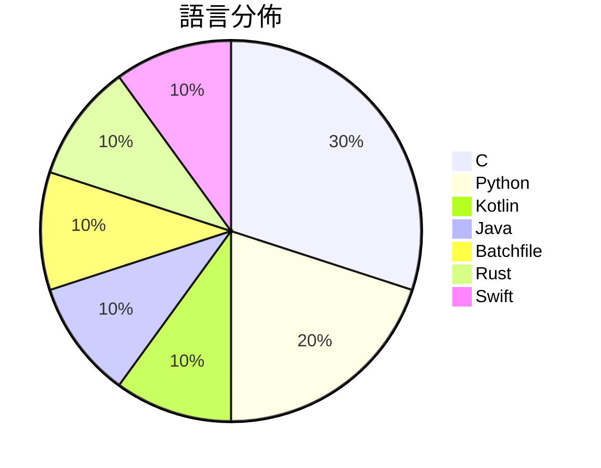

# GitHub Trending - 2026-10-26

> [!summary] 本日摘要
> 收錄 **10** 個新專案，合計 **26.6k** stars
> 語言分佈：C (3) · Python (2) · Kotlin (1) · Java (1) · Batchfile (1) · Rust (1) · Swift (1)

> [!tip] 本週焦點
> **[[pengchujin--aerial-tv|pengchujin/aerial-tv]]** — 5 天內累積 5.3k stars（1.1k stars/天）
> 给国产电视的一块干净桌面：参照 tvOS 设计的开源 Android TV 桌面，没有广告，开机自动接管。A tvOS-style launcher for Xiaomi, TCL and other China-market TVs.



---

## 收錄列表

| # | 專案 | 分類 | Stars | 速度 | 安裝 | 語言 | 用途 |
| :--: | --- | --- | ---: | ---: | --- | --- | --- |
| 1 | [[pengchujin--aerial-tv\|pengchujin/aerial-tv]] |  | 5.3k | 1.1k/天 |  | Kotlin | 给国产电视的一块干净桌面：参照 tvOS 设计的开源 Android TV 桌面 |
| 2 | [[simbasjungles--free-my-tv\|simbasjungles/free-my-tv]] |  | 4.7k | 776/天 |  | Java | A fast, ad-free home screen for Google T |
| 3 | [[JustAResearcher--gpu-unlock-ada\|JustAResearcher/gpu-unlock-ada]] |  | 3.1k | 1.5k/天 |  | C | GPU tensor unlock source for RTX 4090 an |
| 4 | [[JoasASantos--REA-Prompts\|JoasASantos/REA-Prompts]] |  | 2.5k | 420/天 |  | Batchfile | REAP - Prompts for you to use REA (Rever |
| 5 | [[EthanArbuckle--fairplay-decrypt\|EthanArbuckle/fairplay-decrypt]] |  | 2.1k | 355/天 |  | C | Offline FairPlay App Store IPA decryptio |
| 6 | [[xevrion--hatchzip\|xevrion/hatchzip]] |  | 2.0k | 492/天 |  | Rust | HatchZip is a free, open-source archive  |
| 7 | [[wesbos--3d-model-anything\|wesbos/3d-model-anything]] |  | 2.0k | 490/天 |  | Swift | Capture iPhone LiDAR and photos, reconst |
| 8 | [[ikow--php2shell-poc\|ikow/php2shell-poc]] |  | 1.8k | 450/天 |  | Python | CVE-2026-109618/109619 — 5 RCE chains +  |
| 9 | [[Jakeschincariol--day-trader-skill\|Jakeschincariol/day-trader-skill]] |  | 1.7k | 345/天 |  | Python | 11 Claude skills for day trading: scan t |
| 10 | [[oosexgang--hackios-xnu-kernel\|oosexgang/hackios-xnu-kernel]] |  | 1.5k | 499/天 |  | C |  |

---

## 重點摘要

### 1. [[pengchujin--aerial-tv|pengchujin/aerial-tv]]

**5.3k** stars · **1.1k** stars/天 · Kotlin

---

### 2. [[simbasjungles--free-my-tv|simbasjungles/free-my-tv]]

**4.7k** stars · **776** stars/天 · Java

---

### 3. [[JustAResearcher--gpu-unlock-ada|JustAResearcher/gpu-unlock-ada]]

**3.1k** stars · **1.5k** stars/天 · C

---

### 4. [[JoasASantos--REA-Prompts|JoasASantos/REA-Prompts]]

**2.5k** stars · **420** stars/天 · Batchfile

---

### 5. [[EthanArbuckle--fairplay-decrypt|EthanArbuckle/fairplay-decrypt]]

**2.1k** stars · **355** stars/天 · C

---

### 6. [[xevrion--hatchzip|xevrion/hatchzip]]

**2.0k** stars · **492** stars/天 · Rust

---

### 7. [[wesbos--3d-model-anything|wesbos/3d-model-anything]]

**2.0k** stars · **490** stars/天 · Swift

---

### 8. [[ikow--php2shell-poc|ikow/php2shell-poc]]

**1.8k** stars · **450** stars/天 · Python

---

### 9. [[Jakeschincariol--day-trader-skill|Jakeschincariol/day-trader-skill]]

**1.7k** stars · **345** stars/天 · Python

---

### 10. [[oosexgang--hackios-xnu-kernel|oosexgang/hackios-xnu-kernel]]

**1.5k** stars · **499** stars/天 · C

---

## 今日到期複習

> [!tip] 根據間隔複習排程，今天該回顧的專案

```dataview
TABLE
  stars_per_day AS "Stars/天",
  category AS "分類",
  engagement AS "參與度"
FROM "Repos"
WHERE next_review AND date(next_review) <= date("2026-10-26") AND status != "archived"
SORT priority DESC
```

## 待處理

```dataviewjs
const pending = dv.pages('"Repos"').where(p => p.status === "to-review").length;
const unrated = dv.pages('"Repos"').where(p => p.status !== "archived" && p.status !== "to-review" && (p.my_rating || 0) === 0).length;
const noVerdict = dv.pages('"Repos"').where(p => p.status !== "archived" && (p.my_rating || 0) > 0 && (!p.verdict || p.verdict === "")).length;
const items = [];
if (pending > 0) items.push(`**${pending}** 個待分流`);
if (unrated > 0) items.push(`**${unrated}** 個已讀但未評分`);
if (noVerdict > 0) items.push(`**${noVerdict}** 個已評分但無結論`);
if (items.length > 0) dv.paragraph(items.join(" / "));
else dv.paragraph("所有專案都已處理完畢！");
```
