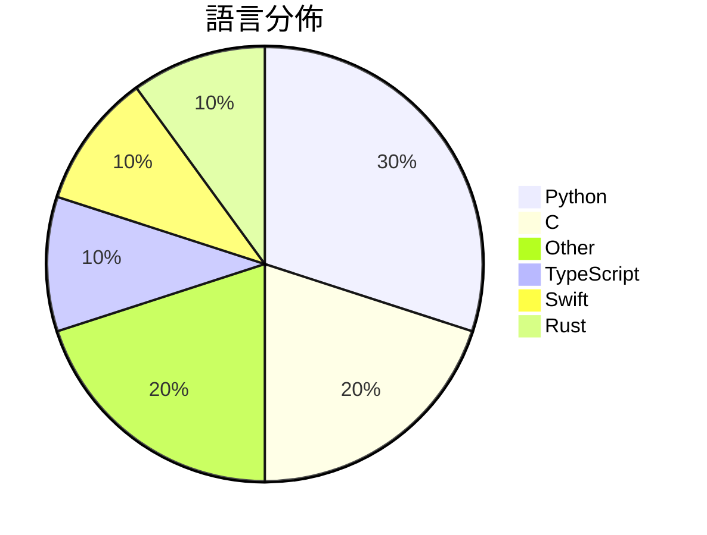

# GitHub Trending - 2026-10-28

> [!summary] 本日摘要
> 收錄 **10** 個新專案，合計 **25.3k** stars
> 語言分佈：Python (3) · C (2) · Other (2) · TypeScript (1) · Swift (1) · Rust (1)

> [!tip] 本週焦點
> **[[JustAResearcher--gpu-unlock-ada|JustAResearcher/gpu-unlock-ada]]** — 4 天內累積 4.3k stars（1.1k stars/天）
> GPU tensor unlock source for RTX 4090 and experimental RTX 4070 Ti SUPER; firmware generated locally



---

## 收錄列表

| # | 專案 | 分類 | Stars | 速度 | 安裝 | 語言 | 用途 |
| :--: | --- | --- | ---: | ---: | --- | --- | --- |
| 1 | [[JustAResearcher--gpu-unlock-ada\|JustAResearcher/gpu-unlock-ada]] |  | 4.3k | 1.1k/天 |  | C | GPU tensor unlock source for RTX 4090 an |
| 2 | [[rddmwmddr--android-ad-cleaner\|rddmwmddr/android-ad-cleaner]] |  | 3.7k | 934/天 |  | Python | 关掉国产安卓手机系统里的广告、热搜、资讯推荐和营销推送。不 root，可还原，支 |
| 3 | [[designfuchen--word-atlas\|designfuchen/word-atlas]] |  | 2.8k | 1.4k/天 |  | TypeScript | 词光 · Word Atlas — Illustrated IELTS voca |
| 4 | [[unclebob--ub-mode\|unclebob/ub-mode]] |  | 2.7k | 1.4k/天 |  | N/A |  |
| 5 | [[wesbos--3d-model-anything\|wesbos/3d-model-anything]] |  | 2.2k | 372/天 |  | Swift | Capture iPhone LiDAR and photos, reconst |
| 6 | [[xevrion--hatchzip\|xevrion/hatchzip]] |  | 2.2k | 369/天 |  | Rust | HatchZip is a free, open-source archive  |
| 7 | [[t3dotgg--tstack\|t3dotgg/tstack]] |  | 2.1k | 518/天 |  | Python | The agent skills I use every day. Works  |
| 8 | [[ikow--php2shell-poc\|ikow/php2shell-poc]] |  | 1.9k | 312/天 |  | Python | CVE-2026-109618/109619 — 5 RCE chains +  |
| 9 | [[oosexgang--hackios-xnu-kernel\|oosexgang/hackios-xnu-kernel]] |  | 1.8k | 308/天 |  | C |  |
| 10 | [[DLSS-5-Swaper-New--.github\|DLSS-5-Swaper-New/.github]] |  | 1.5k | 1.5k/天 |  | N/A | DLSS 5 Swapper is a specialized Windows  |

---

## 重點摘要

### 1. [[JustAResearcher--gpu-unlock-ada|JustAResearcher/gpu-unlock-ada]]

**4.3k** stars · **1.1k** stars/天 · C

---

### 2. [[rddmwmddr--android-ad-cleaner|rddmwmddr/android-ad-cleaner]]

**3.7k** stars · **934** stars/天 · Python

---

### 3. [[designfuchen--word-atlas|designfuchen/word-atlas]]

**2.8k** stars · **1.4k** stars/天 · TypeScript

---

### 4. [[unclebob--ub-mode|unclebob/ub-mode]]

**2.7k** stars · **1.4k** stars/天 · N/A

---

### 5. [[wesbos--3d-model-anything|wesbos/3d-model-anything]]

**2.2k** stars · **372** stars/天 · Swift

---

### 6. [[xevrion--hatchzip|xevrion/hatchzip]]

**2.2k** stars · **369** stars/天 · Rust

---

### 7. [[t3dotgg--tstack|t3dotgg/tstack]]

**2.1k** stars · **518** stars/天 · Python

---

### 8. [[ikow--php2shell-poc|ikow/php2shell-poc]]

**1.9k** stars · **312** stars/天 · Python

---

### 9. [[oosexgang--hackios-xnu-kernel|oosexgang/hackios-xnu-kernel]]

**1.8k** stars · **308** stars/天 · C

---

### 10. [[DLSS-5-Swaper-New--.github|DLSS-5-Swaper-New/.github]]

**1.5k** stars · **1.5k** stars/天 · N/A

---

## 今日到期複習

> [!tip] 根據間隔複習排程，今天該回顧的專案

```dataview
TABLE
  stars_per_day AS "Stars/天",
  category AS "分類",
  engagement AS "參與度"
FROM "Repos"
WHERE next_review AND date(next_review) <= date("2026-10-28") AND status != "archived"
SORT priority DESC
```

## 待處理

```dataviewjs
const pending = dv.pages('"Repos"').where(p => p.status === "to-review").length;
const unrated = dv.pages('"Repos"').where(p => p.status !== "archived" && p.status !== "to-review" && (p.my_rating || 0) === 0).length;
const noVerdict = dv.pages('"Repos"').where(p => p.status !== "archived" && (p.my_rating || 0) > 0 && (!p.verdict || p.verdict === "")).length;
const items = [];
if (pending > 0) items.push(`**${pending}** 個待分流`);
if (unrated > 0) items.push(`**${unrated}** 個已讀但未評分`);
if (noVerdict > 0) items.push(`**${noVerdict}** 個已評分但無結論`);
if (items.length > 0) dv.paragraph(items.join(" / "));
else dv.paragraph("所有專案都已處理完畢！");
```
