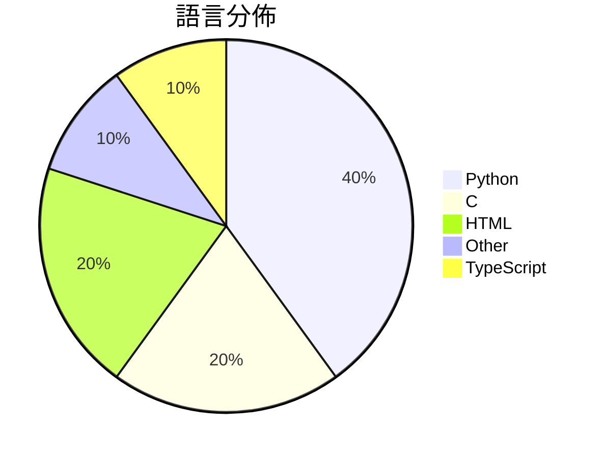

# GitHub Trending - 2026-10-29

> [!summary] 本日摘要
> 收錄 **10** 個新專案，合計 **28.3k** stars
> 語言分佈：Python (4) · C (2) · HTML (2) · Other (1) · TypeScript (1)

> [!tip] 本週焦點
> **[[rddmwmddr--android-ad-cleaner|rddmwmddr/android-ad-cleaner]]** — 5 天內累積 4.5k stars（896 stars/天）
> 关掉国产安卓手机系统里的广告、热搜、资讯推荐和营销推送。不 root，可还原，支持 AI 智能体一键执行。



---

## 收錄列表

| # | 專案 | 分類 | Stars | 速度 | 安裝 | 語言 | 用途 |
| :--: | --- | --- | ---: | ---: | --- | --- | --- |
| 1 | [[rddmwmddr--android-ad-cleaner\|rddmwmddr/android-ad-cleaner]] |  | 4.5k | 896/天 |  | Python | 关掉国产安卓手机系统里的广告、热搜、资讯推荐和营销推送。不 root，可还原，支 |
| 2 | [[JustAResearcher--gpu-unlock-ada\|JustAResearcher/gpu-unlock-ada]] |  | 4.4k | 890/天 |  | C | GPU tensor unlock source for RTX 4090 an |
| 3 | [[unclebob--ub-mode\|unclebob/ub-mode]] |  | 4.0k | 1.3k/天 |  | N/A |  |
| 4 | [[designfuchen--word-atlas\|designfuchen/word-atlas]] |  | 3.1k | 1.0k/天 |  | TypeScript | 词光 · Word Atlas — Illustrated IELTS voca |
| 5 | [[interplains--Zero-Breach-Toolkit\|interplains/Zero-Breach-Toolkit]] |  | 3.0k | 988/天 |  | Python | Free, open-source, offline checks for tr |
| 6 | [[t3dotgg--tstack\|t3dotgg/tstack]] |  | 2.3k | 459/天 |  | Python | The agent skills I use every day. Works  |
| 7 | [[anhao--ai-pose-gallery-zh\|anhao/ai-pose-gallery-zh]] |  | 2.3k | 2.3k/天 |  | HTML | 中文版 AI 姿势参考图库 · 1439 组 / 2878 张图片 / 完整汉化 |
| 8 | [[oosexgang--hakios-xnu-kernel\|oosexgang/hakios-xnu-kernel]] |  | 1.9k | 274/天 |  | C |  |
| 9 | [[enesozturk--dimensional-drawing\|enesozturk/dimensional-drawing]] |  | 1.5k | 291/天 |  | HTML | Create Apple style dimensional drawings  |
| 10 | [[morganlinton--BeautifulRust\|morganlinton/BeautifulRust]] |  | 1.4k | 229/天 |  | Python | Agent Skills that teach coding agents to |

---

## 重點摘要

### 1. [[rddmwmddr--android-ad-cleaner|rddmwmddr/android-ad-cleaner]]

**4.5k** stars · **896** stars/天 · Python

---

### 2. [[JustAResearcher--gpu-unlock-ada|JustAResearcher/gpu-unlock-ada]]

**4.4k** stars · **890** stars/天 · C

---

### 3. [[unclebob--ub-mode|unclebob/ub-mode]]

**4.0k** stars · **1.3k** stars/天 · N/A

---

### 4. [[designfuchen--word-atlas|designfuchen/word-atlas]]

**3.1k** stars · **1.0k** stars/天 · TypeScript

---

### 5. [[interplains--Zero-Breach-Toolkit|interplains/Zero-Breach-Toolkit]]

**3.0k** stars · **988** stars/天 · Python

---

### 6. [[t3dotgg--tstack|t3dotgg/tstack]]

**2.3k** stars · **459** stars/天 · Python

---

### 7. [[anhao--ai-pose-gallery-zh|anhao/ai-pose-gallery-zh]]

**2.3k** stars · **2.3k** stars/天 · HTML

---

### 8. [[oosexgang--hakios-xnu-kernel|oosexgang/hakios-xnu-kernel]]

**1.9k** stars · **274** stars/天 · C

---

### 9. [[enesozturk--dimensional-drawing|enesozturk/dimensional-drawing]]

**1.5k** stars · **291** stars/天 · HTML

---

### 10. [[morganlinton--BeautifulRust|morganlinton/BeautifulRust]]

**1.4k** stars · **229** stars/天 · Python

---

## 今日到期複習

> [!tip] 根據間隔複習排程，今天該回顧的專案

```dataview
TABLE
  stars_per_day AS "Stars/天",
  category AS "分類",
  engagement AS "參與度"
FROM "Repos"
WHERE next_review AND date(next_review) <= date("2026-10-29") AND status != "archived"
SORT priority DESC
```

## 待處理

```dataviewjs
const pending = dv.pages('"Repos"').where(p => p.status === "to-review").length;
const unrated = dv.pages('"Repos"').where(p => p.status !== "archived" && p.status !== "to-review" && (p.my_rating || 0) === 0).length;
const noVerdict = dv.pages('"Repos"').where(p => p.status !== "archived" && (p.my_rating || 0) > 0 && (!p.verdict || p.verdict === "")).length;
const items = [];
if (pending > 0) items.push(`**${pending}** 個待分流`);
if (unrated > 0) items.push(`**${unrated}** 個已讀但未評分`);
if (noVerdict > 0) items.push(`**${noVerdict}** 個已評分但無結論`);
if (items.length > 0) dv.paragraph(items.join(" / "));
else dv.paragraph("所有專案都已處理完畢！");
```
