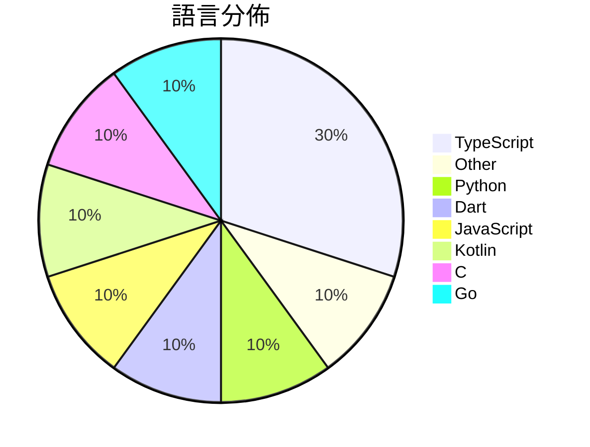

# GitHub Trending - 2026-11-01

> [!summary] 本日摘要
> 收錄 **10** 個新專案，合計 **37.7k** stars
> 語言分佈：TypeScript (3) · Other (1) · Python (1) · Dart (1) · JavaScript (1) · Kotlin (1) · C (1) · Go (1)

> [!tip] 本週焦點
> **[[unclebob--ub-mode|unclebob/ub-mode]]** — 6 天內累積 5.9k stars（986 stars/天）
> 



---

## 收錄列表

| # | 專案 | 分類 | Stars | 速度 | 安裝 | 語言 | 用途 |
| :--: | --- | --- | ---: | ---: | --- | --- | --- |
| 1 | [[unclebob--ub-mode\|unclebob/ub-mode]] |  | 5.9k | 986/天 |  | N/A |  |
| 2 | [[anhao--ai-pose-gallery-zh\|anhao/ai-pose-gallery-zh]] |  | 4.9k | 1.2k/天 |  | TypeScript | 中文版 AI 姿势参考图库 · 1439 组 / 2878 张图片 / 完整汉化 |
| 3 | [[deepseek-ai--dsh-superagent-prototype\|deepseek-ai/dsh-superagent-prototype]] |  | 4.0k | 4.0k/天 |  | TypeScript | Towards a More Autonomous Agent System |
| 4 | [[interplains--Zero-Breach-Toolkit\|interplains/Zero-Breach-Toolkit]] |  | 4.0k | 671/天 |  | Python | Free, open-source, offline checks for tr |
| 5 | [[ccch1mneyyy--dsh-Go\|ccch1mneyyy/dsh-Go]] |  | 3.9k | 646/天 |  | Dart | dsh-go — DeepSeek Harness 装进口袋：手机本机运行，也能 |
| 6 | [[heydamir--unslop\|heydamir/unslop]] |  | 3.8k | 1.9k/天 |  | JavaScript | A Claude skill that turns vibecoded, AI- |
| 7 | [[designfuchen--word-atlas\|designfuchen/word-atlas]] |  | 3.6k | 599/天 |  | TypeScript | 词光 · Word Atlas — Illustrated IELTS voca |
| 8 | [[wangzan101--Mika\|wangzan101/Mika]] |  | 3.0k | 1.5k/天 |  | Kotlin | An on-device AI agent for Android that o |
| 9 | [[valentderah--totk-pc-recomp\|valentderah/totk-pc-recomp]] |  | 2.8k | 1.4k/天 |  | C | Static recompilation of The Legend of Ze |
| 10 | [[paipiange--nvzhuang\|paipiange/nvzhuang]] |  | 1.8k | 598/天 |  | Go | 1407 张 AI 女装参考图集与虚拟试穿网站，支持中英检索、OpenAI Im |

---

## 重點摘要

### 1. [[unclebob--ub-mode|unclebob/ub-mode]]

**5.9k** stars · **986** stars/天 · N/A

---

### 2. [[anhao--ai-pose-gallery-zh|anhao/ai-pose-gallery-zh]]

**4.9k** stars · **1.2k** stars/天 · TypeScript

---

### 3. [[deepseek-ai--dsh-superagent-prototype|deepseek-ai/dsh-superagent-prototype]]

**4.0k** stars · **4.0k** stars/天 · TypeScript

---

### 4. [[interplains--Zero-Breach-Toolkit|interplains/Zero-Breach-Toolkit]]

**4.0k** stars · **671** stars/天 · Python

---

### 5. [[ccch1mneyyy--dsh-Go|ccch1mneyyy/dsh-Go]]

**3.9k** stars · **646** stars/天 · Dart

---

### 6. [[heydamir--unslop|heydamir/unslop]]

**3.8k** stars · **1.9k** stars/天 · JavaScript

---

### 7. [[designfuchen--word-atlas|designfuchen/word-atlas]]

**3.6k** stars · **599** stars/天 · TypeScript

---

### 8. [[wangzan101--Mika|wangzan101/Mika]]

**3.0k** stars · **1.5k** stars/天 · Kotlin

---

### 9. [[valentderah--totk-pc-recomp|valentderah/totk-pc-recomp]]

**2.8k** stars · **1.4k** stars/天 · C

---

### 10. [[paipiange--nvzhuang|paipiange/nvzhuang]]

**1.8k** stars · **598** stars/天 · Go

---

## 今日到期複習

> [!tip] 根據間隔複習排程，今天該回顧的專案

```dataview
TABLE
  stars_per_day AS "Stars/天",
  category AS "分類",
  engagement AS "參與度"
FROM "Repos"
WHERE next_review AND date(next_review) <= date("2026-11-01") AND status != "archived"
SORT priority DESC
```

## 待處理

```dataviewjs
const pending = dv.pages('"Repos"').where(p => p.status === "to-review").length;
const unrated = dv.pages('"Repos"').where(p => p.status !== "archived" && p.status !== "to-review" && (p.my_rating || 0) === 0).length;
const noVerdict = dv.pages('"Repos"').where(p => p.status !== "archived" && (p.my_rating || 0) > 0 && (!p.verdict || p.verdict === "")).length;
const items = [];
if (pending > 0) items.push(`**${pending}** 個待分流`);
if (unrated > 0) items.push(`**${unrated}** 個已讀但未評分`);
if (noVerdict > 0) items.push(`**${noVerdict}** 個已評分但無結論`);
if (items.length > 0) dv.paragraph(items.join(" / "));
else dv.paragraph("所有專案都已處理完畢！");
```
