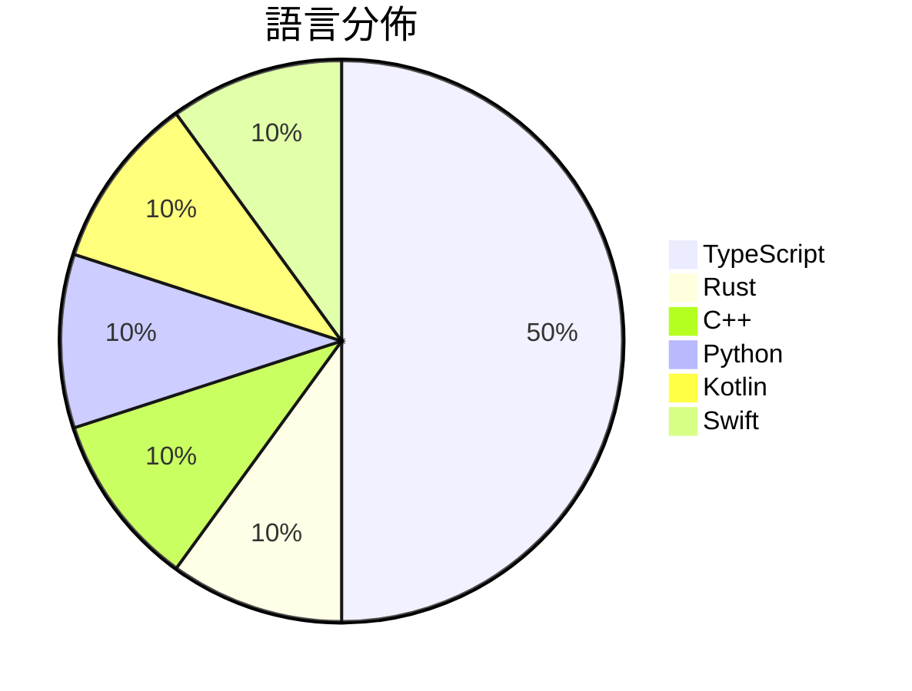

# GitHub Trending - 2026-11-07

> [!summary] 本日摘要
> 收錄 **10** 個新專案，合計 **61.0k** stars
> 語言分佈：TypeScript (5) · Rust (1) · C++ (1) · Python (1) · Kotlin (1) · Swift (1)

> [!tip] 本週焦點
> **[[deepseek-ai--dsh-superagent-prototype|deepseek-ai/dsh-superagent-prototype]]** — 6 天內累積 20.4k stars（3.4k stars/天）
> Towards a More Autonomous Agent System



---

## 收錄列表

| # | 專案 | 分類 | Stars | 速度 | 安裝 | 語言 | 用途 |
| :--: | --- | --- | ---: | ---: | --- | --- | --- |
| 1 | [[deepseek-ai--dsh-superagent-prototype\|deepseek-ai/dsh-superagent-prototype]] |  | 20.4k | 3.4k/天 |  | TypeScript | Towards a More Autonomous Agent System |
| 2 | [[storytold--craft-anything\|storytold/craft-anything]] |  | 18.7k | 3.1k/天 |  | Rust | Craft Anything: understand how any softw |
| 3 | [[zortos293--Lichii\|zortos293/Lichii]] |  | 4.2k | 708/天 |  | C++ | VERY experimental Nintendo Switch 2 emul |
| 4 | [[KKKKhazix--agent-autoloop\|KKKKhazix/agent-autoloop]] |  | 3.8k | 1.3k/天 |  | TypeScript | 让你的命令行 Agent 在后台自己接活、自己跟进到底；平时不烦你，遇到拿不准的 |
| 5 | [[worldonlyu--Google_AI_Pro_2Year_ZeroCost_Auto\|worldonlyu/Google_AI_Pro_2Year_ZeroCost_Auto]] |  | 2.9k | 1.5k/天 |  | Python | Google_AI_Pro_2Year_ZeroCost_Auto |
| 6 | [[Verlintas--NOIR\|Verlintas/NOIR]] |  | 2.8k | 468/天 |  | Kotlin | 手机隐私审计：用 adb 扫出 Android 应用的权限、上报端点与数据流向， |
| 7 | [[govijr--terminal-mac\|govijr/terminal-mac]] |  | 2.2k | 546/天 |  | Swift | Entire MacOS running in your terminal. |
| 8 | [[mromidev--claude-animated-shorts\|mromidev/claude-animated-shorts]] |  | 2.1k | 343/天 |  | TypeScript | Free Claude skill: viral animated story  |
| 9 | [[caru-ini--stack-diagram\|caru-ini/stack-diagram]] |  | 2.0k | 332/天 |  | TypeScript | Agent skill: describe your stack in a se |
| 10 | [[Minireel--HGhub\|Minireel/HGhub]] |  | 1.8k | 612/天 |  | TypeScript | YellowFruit third-party client |

---

## 重點摘要

### 1. [[deepseek-ai--dsh-superagent-prototype|deepseek-ai/dsh-superagent-prototype]]

**20.4k** stars · **3.4k** stars/天 · TypeScript

---

### 2. [[storytold--craft-anything|storytold/craft-anything]]

**18.7k** stars · **3.1k** stars/天 · Rust

---

### 3. [[zortos293--Lichii|zortos293/Lichii]]

**4.2k** stars · **708** stars/天 · C++

---

### 4. [[KKKKhazix--agent-autoloop|KKKKhazix/agent-autoloop]]

**3.8k** stars · **1.3k** stars/天 · TypeScript

---

### 5. [[worldonlyu--Google_AI_Pro_2Year_ZeroCost_Auto|worldonlyu/Google_AI_Pro_2Year_ZeroCost_Auto]]

**2.9k** stars · **1.5k** stars/天 · Python

---

### 6. [[Verlintas--NOIR|Verlintas/NOIR]]

**2.8k** stars · **468** stars/天 · Kotlin

---

### 7. [[govijr--terminal-mac|govijr/terminal-mac]]

**2.2k** stars · **546** stars/天 · Swift

---

### 8. [[mromidev--claude-animated-shorts|mromidev/claude-animated-shorts]]

**2.1k** stars · **343** stars/天 · TypeScript

---

### 9. [[caru-ini--stack-diagram|caru-ini/stack-diagram]]

**2.0k** stars · **332** stars/天 · TypeScript

---

### 10. [[Minireel--HGhub|Minireel/HGhub]]

**1.8k** stars · **612** stars/天 · TypeScript

---

## 今日到期複習

> [!tip] 根據間隔複習排程，今天該回顧的專案

```dataview
TABLE
  stars_per_day AS "Stars/天",
  category AS "分類",
  engagement AS "參與度"
FROM "Repos"
WHERE next_review AND date(next_review) <= date("2026-11-07") AND status != "archived"
SORT priority DESC
```

## 待處理

```dataviewjs
const pending = dv.pages('"Repos"').where(p => p.status === "to-review").length;
const unrated = dv.pages('"Repos"').where(p => p.status !== "archived" && p.status !== "to-review" && (p.my_rating || 0) === 0).length;
const noVerdict = dv.pages('"Repos"').where(p => p.status !== "archived" && (p.my_rating || 0) > 0 && (!p.verdict || p.verdict === "")).length;
const items = [];
if (pending > 0) items.push(`**${pending}** 個待分流`);
if (unrated > 0) items.push(`**${unrated}** 個已讀但未評分`);
if (noVerdict > 0) items.push(`**${noVerdict}** 個已評分但無結論`);
if (items.length > 0) dv.paragraph(items.join(" / "));
else dv.paragraph("所有專案都已處理完畢！");
```
