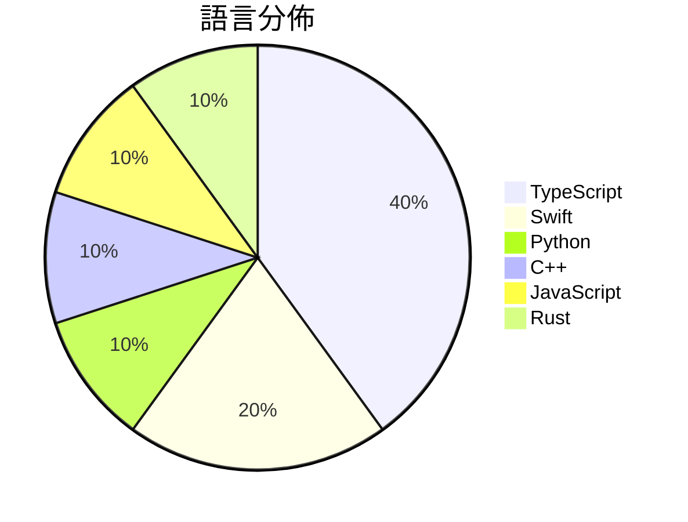

# GitHub Trending - 2026-11-08

> [!summary] 本日摘要
> 收錄 **10** 個新專案，合計 **23.1k** stars
> 語言分佈：TypeScript (4) · Swift (2) · Python (1) · C++ (1) · JavaScript (1) · Rust (1)

> [!tip] 本週焦點
> **[[KKKKhazix--agent-autoloop|KKKKhazix/agent-autoloop]]** — 4 天內累積 4.0k stars（1.0k stars/天）
> 让你的命令行 Agent 在后台自己接活、自己跟进到底；平时不烦你，遇到拿不准的事才发卡片找你拍板。



---

## 收錄列表

| # | 專案 | 分類 | Stars | 速度 | 安裝 | 語言 | 用途 |
| :--: | --- | --- | ---: | ---: | --- | --- | --- |
| 1 | [[KKKKhazix--agent-autoloop\|KKKKhazix/agent-autoloop]] |  | 4.0k | 1.0k/天 |  | TypeScript | 让你的命令行 Agent 在后台自己接活、自己跟进到底；平时不烦你，遇到拿不准的 |
| 2 | [[worldonlyu--Google_AI_Pro_2Year_ZeroCost_Auto\|worldonlyu/Google_AI_Pro_2Year_ZeroCost_Auto]] |  | 3.1k | 1.0k/天 |  | Python | Google_AI_Pro_2Year_ZeroCost_Auto |
| 3 | [[Minireel--HGhub\|Minireel/HGhub]] |  | 2.5k | 627/天 |  | TypeScript | YellowFruit third-party client |
| 4 | [[govijr--terminal-mac\|govijr/terminal-mac]] |  | 2.3k | 458/天 |  | Swift | Entire MacOS running in your terminal. |
| 5 | [[mromidev--claude-animated-shorts\|mromidev/claude-animated-shorts]] |  | 2.3k | 326/天 |  | TypeScript | Free Claude skill: viral animated story  |
| 6 | [[NotRexed--Hookshot\|NotRexed/Hookshot]] |  | 2.1k | 1.0k/天 |  | C++ | A Native Recompilation Of The Legend Of  |
| 7 | [[caru-ini--stack-diagram\|caru-ini/stack-diagram]] |  | 2.1k | 298/天 |  | TypeScript | Agent skill: describe your stack in a se |
| 8 | [[JenkinWoo--sheeridVerify\|JenkinWoo/sheeridVerify]] |  | 1.8k | 1.8k/天 |  | JavaScript |  |
| 9 | [[wquguru--cicada\|wquguru/cicada]] |  | 1.7k | 241/天 |  | Swift | 知了 Cicada · 任何会议和直播的实时字幕、同声传译、AI 会议纪要，Ma |
| 10 | [[s1dashu--quiet-md\|s1dashu/quiet-md]] |  | 1.3k | 216/天 |  | Rust | Blazing-fast native notes app for macOS  |

---

## 重點摘要

### 1. [[KKKKhazix--agent-autoloop|KKKKhazix/agent-autoloop]]

**4.0k** stars · **1.0k** stars/天 · TypeScript

---

### 2. [[worldonlyu--Google_AI_Pro_2Year_ZeroCost_Auto|worldonlyu/Google_AI_Pro_2Year_ZeroCost_Auto]]

**3.1k** stars · **1.0k** stars/天 · Python

---

### 3. [[Minireel--HGhub|Minireel/HGhub]]

**2.5k** stars · **627** stars/天 · TypeScript

---

### 4. [[govijr--terminal-mac|govijr/terminal-mac]]

**2.3k** stars · **458** stars/天 · Swift

---

### 5. [[mromidev--claude-animated-shorts|mromidev/claude-animated-shorts]]

**2.3k** stars · **326** stars/天 · TypeScript

---

### 6. [[NotRexed--Hookshot|NotRexed/Hookshot]]

**2.1k** stars · **1.0k** stars/天 · C++

---

### 7. [[caru-ini--stack-diagram|caru-ini/stack-diagram]]

**2.1k** stars · **298** stars/天 · TypeScript

---

### 8. [[JenkinWoo--sheeridVerify|JenkinWoo/sheeridVerify]]

**1.8k** stars · **1.8k** stars/天 · JavaScript

---

### 9. [[wquguru--cicada|wquguru/cicada]]

**1.7k** stars · **241** stars/天 · Swift

---

### 10. [[s1dashu--quiet-md|s1dashu/quiet-md]]

**1.3k** stars · **216** stars/天 · Rust

---

## 今日到期複習

> [!tip] 根據間隔複習排程，今天該回顧的專案

```dataview
TABLE
  stars_per_day AS "Stars/天",
  category AS "分類",
  engagement AS "參與度"
FROM "Repos"
WHERE next_review AND date(next_review) <= date("2026-11-08") AND status != "archived"
SORT priority DESC
```

## 待處理

```dataviewjs
const pending = dv.pages('"Repos"').where(p => p.status === "to-review").length;
const unrated = dv.pages('"Repos"').where(p => p.status !== "archived" && p.status !== "to-review" && (p.my_rating || 0) === 0).length;
const noVerdict = dv.pages('"Repos"').where(p => p.status !== "archived" && (p.my_rating || 0) > 0 && (!p.verdict || p.verdict === "")).length;
const items = [];
if (pending > 0) items.push(`**${pending}** 個待分流`);
if (unrated > 0) items.push(`**${unrated}** 個已讀但未評分`);
if (noVerdict > 0) items.push(`**${noVerdict}** 個已評分但無結論`);
if (items.length > 0) dv.paragraph(items.join(" / "));
else dv.paragraph("所有專案都已處理完畢！");
```
