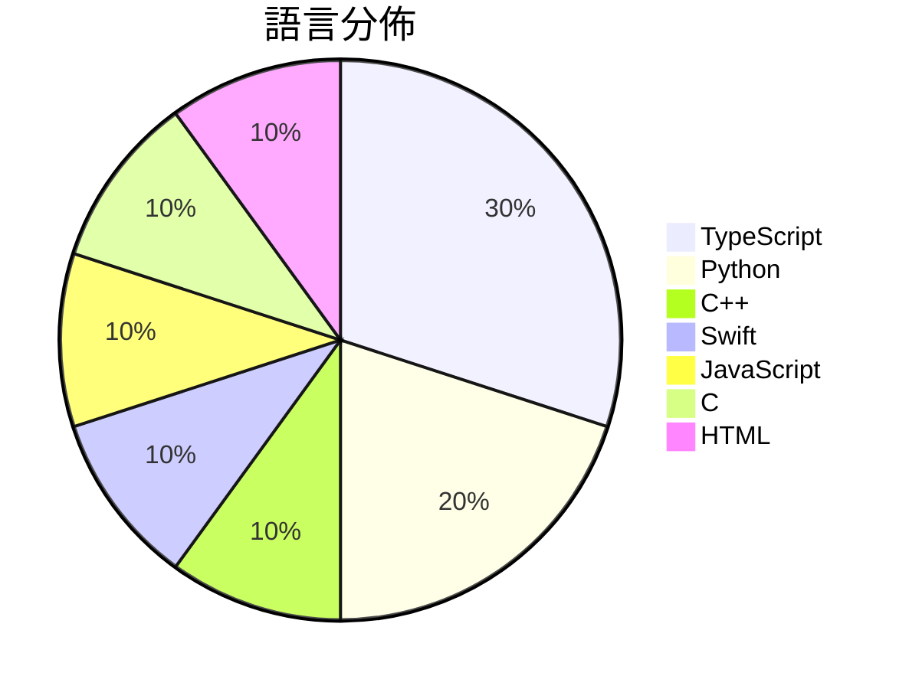

# GitHub Trending - 2026-11-09

> [!summary] 本日摘要
> 收錄 **10** 個新專案，合計 **25.5k** stars
> 語言分佈：TypeScript (3) · Python (2) · C++ (1) · Swift (1) · JavaScript (1) · C (1) · HTML (1)

> [!tip] 本週焦點
> **[[KKKKhazix--agent-autoloop|KKKKhazix/agent-autoloop]]** — 5 天內累積 4.2k stars（837 stars/天）
> 让你的命令行 Agent 在后台自己接活、自己跟进到底；平时不烦你，遇到拿不准的事才发卡片找你拍板。



---

## 收錄列表

| # | 專案 | 分類 | Stars | 速度 | 安裝 | 語言 | 用途 |
| :--: | --- | --- | ---: | ---: | --- | --- | --- |
| 1 | [[KKKKhazix--agent-autoloop\|KKKKhazix/agent-autoloop]] |  | 4.2k | 837/天 |  | TypeScript | 让你的命令行 Agent 在后台自己接活、自己跟进到底；平时不烦你，遇到拿不准的 |
| 2 | [[Minireel--HGhub\|Minireel/HGhub]] |  | 4.2k | 834/天 |  | TypeScript | YellowFruit third-party client |
| 3 | [[NotRexed--Hookshot\|NotRexed/Hookshot]] |  | 3.4k | 1.1k/天 |  | C++ | A Native Recompilation Of The Legend Of  |
| 4 | [[worldonlyu--Google_AI_Pro_2Year_ZeroCost_Auto\|worldonlyu/Google_AI_Pro_2Year_ZeroCost_Auto]] |  | 3.3k | 825/天 |  | Python | Google_AI_Pro_2Year_ZeroCost_Auto |
| 5 | [[govijr--terminal-mac\|govijr/terminal-mac]] |  | 2.4k | 406/天 |  | Swift | Entire MacOS running in your terminal. |
| 6 | [[JenkinWoo--sheeridVerify\|JenkinWoo/sheeridVerify]] |  | 1.9k | 945/天 |  | JavaScript |  |
| 7 | [[sarpstar--cinecode\|sarpstar/cinecode]] |  | 1.7k | 338/天 |  | Python | Films made with code. Short films, long  |
| 8 | [[tangerineturtle1--NX2navi\|tangerineturtle1/NX2navi]] |  | 1.6k | 1.6k/天 |  | C |  |
| 9 | [[Sandflow-ai--sand3d\|Sandflow-ai/sand3d]] |  | 1.5k | 298/天 |  | HTML | 3D modeling in Python, built for LLMs. |
| 10 | [[livliv-dev--player\|livliv-dev/player]] |  | 1.4k | 272/天 |  | TypeScript | A lightweight 2.5D character player for  |

---

## 重點摘要

### 1. [[KKKKhazix--agent-autoloop|KKKKhazix/agent-autoloop]]

**4.2k** stars · **837** stars/天 · TypeScript

---

### 2. [[Minireel--HGhub|Minireel/HGhub]]

**4.2k** stars · **834** stars/天 · TypeScript

---

### 3. [[NotRexed--Hookshot|NotRexed/Hookshot]]

**3.4k** stars · **1.1k** stars/天 · C++

---

### 4. [[worldonlyu--Google_AI_Pro_2Year_ZeroCost_Auto|worldonlyu/Google_AI_Pro_2Year_ZeroCost_Auto]]

**3.3k** stars · **825** stars/天 · Python

---

### 5. [[govijr--terminal-mac|govijr/terminal-mac]]

**2.4k** stars · **406** stars/天 · Swift

---

### 6. [[JenkinWoo--sheeridVerify|JenkinWoo/sheeridVerify]]

**1.9k** stars · **945** stars/天 · JavaScript

---

### 7. [[sarpstar--cinecode|sarpstar/cinecode]]

**1.7k** stars · **338** stars/天 · Python

---

### 8. [[tangerineturtle1--NX2navi|tangerineturtle1/NX2navi]]

**1.6k** stars · **1.6k** stars/天 · C

---

### 9. [[Sandflow-ai--sand3d|Sandflow-ai/sand3d]]

**1.5k** stars · **298** stars/天 · HTML

---

### 10. [[livliv-dev--player|livliv-dev/player]]

**1.4k** stars · **272** stars/天 · TypeScript

---

## 今日到期複習

> [!tip] 根據間隔複習排程，今天該回顧的專案

```dataview
TABLE
  stars_per_day AS "Stars/天",
  category AS "分類",
  engagement AS "參與度"
FROM "Repos"
WHERE next_review AND date(next_review) <= date("2026-11-09") AND status != "archived"
SORT priority DESC
```

## 待處理

```dataviewjs
const pending = dv.pages('"Repos"').where(p => p.status === "to-review").length;
const unrated = dv.pages('"Repos"').where(p => p.status !== "archived" && p.status !== "to-review" && (p.my_rating || 0) === 0).length;
const noVerdict = dv.pages('"Repos"').where(p => p.status !== "archived" && (p.my_rating || 0) > 0 && (!p.verdict || p.verdict === "")).length;
const items = [];
if (pending > 0) items.push(`**${pending}** 個待分流`);
if (unrated > 0) items.push(`**${unrated}** 個已讀但未評分`);
if (noVerdict > 0) items.push(`**${noVerdict}** 個已評分但無結論`);
if (items.length > 0) dv.paragraph(items.join(" / "));
else dv.paragraph("所有專案都已處理完畢！");
```
