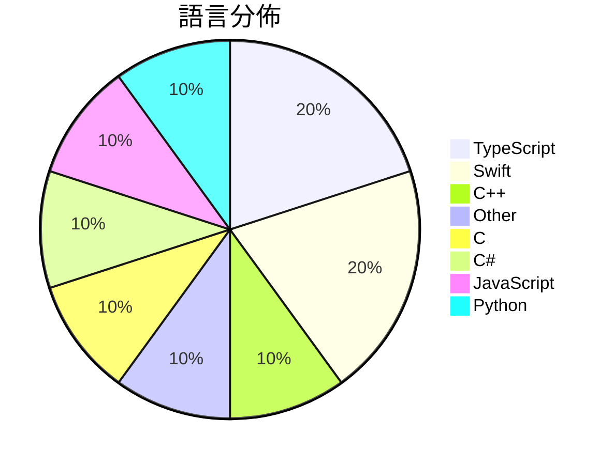

# GitHub Trending - 2026-11-10

> [!summary] 本日摘要
> 收錄 **10** 個新專案，合計 **34.2k** stars
> 語言分佈：TypeScript (2) · Swift (2) · C++ (1) · Other (1) · C (1) · C# (1) · JavaScript (1) · Python (1)

> [!tip] 本週焦點
> **[[Minireel--HGhub|Minireel/HGhub]]** — 6 天內累積 7.2k stars（1.2k stars/天）
> YellowFruit third-party client



---

## 收錄列表

| # | 專案 | 分類 | Stars | 速度 | 安裝 | 語言 | 用途 |
| :--: | --- | --- | ---: | ---: | --- | --- | --- |
| 1 | [[Minireel--HGhub\|Minireel/HGhub]] |  | 7.2k | 1.2k/天 |  | TypeScript | YellowFruit third-party client |
| 2 | [[NotRexed--Hookshot\|NotRexed/Hookshot]] |  | 5.5k | 1.4k/天 |  | C++ | A Native Recompilation Of The Legend Of  |
| 3 | [[KKKKhazix--agent-autoloop\|KKKKhazix/agent-autoloop]] |  | 4.4k | 726/天 |  | TypeScript | 让你的命令行 Agent 在后台自己接活、自己跟进到底；平时不烦你，遇到拿不准的 |
| 4 | [[huamidev--GestaltX\|huamidev/GestaltX]] |  | 3.3k | 3.3k/天 |  | Swift | An MobileGestalt editor for iOS 27.x, fe |
| 5 | [[janestreet--agent_skills\|janestreet/agent_skills]] |  | 2.6k | 440/天 |  | N/A | Agent skills |
| 6 | [[tangerineturtle1--NX2navi\|tangerineturtle1/NX2navi]] |  | 2.6k | 1.3k/天 |  | C |  |
| 7 | [[govijr--terminal-mac\|govijr/terminal-mac]] |  | 2.5k | 361/天 |  | Swift | Entire MacOS running in your terminal. |
| 8 | [[jhaizhou-ops--S2Arm\|jhaizhou-ops/S2Arm]] |  | 2.1k | 1.1k/天 |  | C# | Run your own Switch games natively on iP |
| 9 | [[JenkinWoo--sheeridVerify\|JenkinWoo/sheeridVerify]] |  | 2.0k | 660/天 |  | JavaScript |  |
| 10 | [[sarpstar--cinecode\|sarpstar/cinecode]] |  | 2.0k | 327/天 |  | Python | Films made with code. Short films, long  |

---

## 重點摘要

### 1. [[Minireel--HGhub|Minireel/HGhub]]

**7.2k** stars · **1.2k** stars/天 · TypeScript

---

### 2. [[NotRexed--Hookshot|NotRexed/Hookshot]]

**5.5k** stars · **1.4k** stars/天 · C++

---

### 3. [[KKKKhazix--agent-autoloop|KKKKhazix/agent-autoloop]]

**4.4k** stars · **726** stars/天 · TypeScript

---

### 4. [[huamidev--GestaltX|huamidev/GestaltX]]

**3.3k** stars · **3.3k** stars/天 · Swift

---

### 5. [[janestreet--agent_skills|janestreet/agent_skills]]

**2.6k** stars · **440** stars/天 · N/A

---

### 6. [[tangerineturtle1--NX2navi|tangerineturtle1/NX2navi]]

**2.6k** stars · **1.3k** stars/天 · C

---

### 7. [[govijr--terminal-mac|govijr/terminal-mac]]

**2.5k** stars · **361** stars/天 · Swift

---

### 8. [[jhaizhou-ops--S2Arm|jhaizhou-ops/S2Arm]]

**2.1k** stars · **1.1k** stars/天 · C#

---

### 9. [[JenkinWoo--sheeridVerify|JenkinWoo/sheeridVerify]]

**2.0k** stars · **660** stars/天 · JavaScript

---

### 10. [[sarpstar--cinecode|sarpstar/cinecode]]

**2.0k** stars · **327** stars/天 · Python

---

## 今日到期複習

> [!tip] 根據間隔複習排程，今天該回顧的專案

```dataview
TABLE
  stars_per_day AS "Stars/天",
  category AS "分類",
  engagement AS "參與度"
FROM "Repos"
WHERE next_review AND date(next_review) <= date("2026-11-10") AND status != "archived"
SORT priority DESC
```

## 待處理

```dataviewjs
const pending = dv.pages('"Repos"').where(p => p.status === "to-review").length;
const unrated = dv.pages('"Repos"').where(p => p.status !== "archived" && p.status !== "to-review" && (p.my_rating || 0) === 0).length;
const noVerdict = dv.pages('"Repos"').where(p => p.status !== "archived" && (p.my_rating || 0) > 0 && (!p.verdict || p.verdict === "")).length;
const items = [];
if (pending > 0) items.push(`**${pending}** 個待分流`);
if (unrated > 0) items.push(`**${unrated}** 個已讀但未評分`);
if (noVerdict > 0) items.push(`**${noVerdict}** 個已評分但無結論`);
if (items.length > 0) dv.paragraph(items.join(" / "));
else dv.paragraph("所有專案都已處理完畢！");
```
