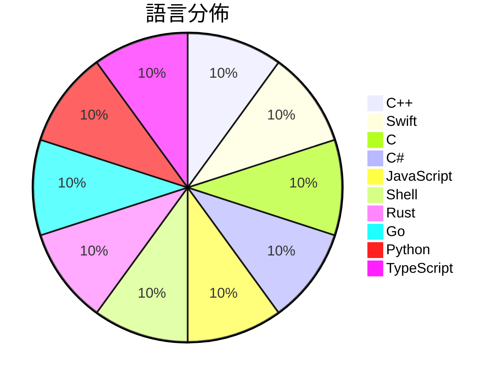

# GitHub Trending - 2026-11-11

> [!summary] 本日摘要
> 收錄 **10** 個新專案，合計 **28.4k** stars
> 語言分佈：C++ (1) · Swift (1) · C (1) · C# (1) · JavaScript (1) · Shell (1) · Rust (1) · Go (1) · Python (1) · TypeScript (1)

> [!tip] 本週焦點
> **[[NotRexed--Hookshot|NotRexed/Hookshot]]** — 5 天內累積 6.9k stars（1.4k stars/天）
> A Native Recompilation Of The Legend Of Zelda: Ocarina Of Time Nintendo Switch 2 Remake



---

## 收錄列表

| # | 專案 | 分類 | Stars | 速度 | 安裝 | 語言 | 用途 |
| :--: | --- | --- | ---: | ---: | --- | --- | --- |
| 1 | [[NotRexed--Hookshot\|NotRexed/Hookshot]] |  | 6.9k | 1.4k/天 |  | C++ | A Native Recompilation Of The Legend Of  |
| 2 | [[huamidev--GestaltX\|huamidev/GestaltX]] |  | 5.5k | 2.7k/天 |  | Swift | An MobileGestalt editor for iOS 27.x, fe |
| 3 | [[tangerineturtle1--NX2navi\|tangerineturtle1/NX2navi]] |  | 3.0k | 992/天 |  | C |  |
| 4 | [[jhaizhou-ops--S2Arm\|jhaizhou-ops/S2Arm]] |  | 2.5k | 827/天 |  | C# | Run your own Switch games natively on iP |
| 5 | [[JenkinWoo--sheeridVerify\|JenkinWoo/sheeridVerify]] |  | 2.0k | 504/天 |  | JavaScript |  |
| 6 | [[IainKay--ram-altman\|IainKay/ram-altman]] |  | 1.8k | 369/天 |  | Shell | Monitors your RAM and reports any "quite |
| 7 | [[jamesondh--chimera-vocal-synth\|jamesondh/chimera-vocal-synth]] |  | 1.8k | 356/天 |  | Rust | the ultimate vocal synthesizer - sing, s |
| 8 | [[DIYgod--pinky\|DIYgod/pinky]] |  | 1.8k | 442/天 |  | Go | Let AI agents use your phone, with you i |
| 9 | [[mmdoctor--google-pro-helper\|mmdoctor/google-pro-helper]] |  | 1.7k | 279/天 |  | Python |  |
| 10 | [[livliv-dev--player\|livliv-dev/player]] |  | 1.5k | 211/天 |  | TypeScript | A lightweight 2.5D character player for  |

---

## 重點摘要

### 1. [[NotRexed--Hookshot|NotRexed/Hookshot]]

**6.9k** stars · **1.4k** stars/天 · C++

---

### 2. [[huamidev--GestaltX|huamidev/GestaltX]]

**5.5k** stars · **2.7k** stars/天 · Swift

---

### 3. [[tangerineturtle1--NX2navi|tangerineturtle1/NX2navi]]

**3.0k** stars · **992** stars/天 · C

---

### 4. [[jhaizhou-ops--S2Arm|jhaizhou-ops/S2Arm]]

**2.5k** stars · **827** stars/天 · C#

---

### 5. [[JenkinWoo--sheeridVerify|JenkinWoo/sheeridVerify]]

**2.0k** stars · **504** stars/天 · JavaScript

---

### 6. [[IainKay--ram-altman|IainKay/ram-altman]]

**1.8k** stars · **369** stars/天 · Shell

---

### 7. [[jamesondh--chimera-vocal-synth|jamesondh/chimera-vocal-synth]]

**1.8k** stars · **356** stars/天 · Rust

---

### 8. [[DIYgod--pinky|DIYgod/pinky]]

**1.8k** stars · **442** stars/天 · Go

---

### 9. [[mmdoctor--google-pro-helper|mmdoctor/google-pro-helper]]

**1.7k** stars · **279** stars/天 · Python

---

### 10. [[livliv-dev--player|livliv-dev/player]]

**1.5k** stars · **211** stars/天 · TypeScript

---

## 今日到期複習

> [!tip] 根據間隔複習排程，今天該回顧的專案

```dataview
TABLE
  stars_per_day AS "Stars/天",
  category AS "分類",
  engagement AS "參與度"
FROM "Repos"
WHERE next_review AND date(next_review) <= date("2026-11-11") AND status != "archived"
SORT priority DESC
```

## 待處理

```dataviewjs
const pending = dv.pages('"Repos"').where(p => p.status === "to-review").length;
const unrated = dv.pages('"Repos"').where(p => p.status !== "archived" && p.status !== "to-review" && (p.my_rating || 0) === 0).length;
const noVerdict = dv.pages('"Repos"').where(p => p.status !== "archived" && (p.my_rating || 0) > 0 && (!p.verdict || p.verdict === "")).length;
const items = [];
if (pending > 0) items.push(`**${pending}** 個待分流`);
if (unrated > 0) items.push(`**${unrated}** 個已讀但未評分`);
if (noVerdict > 0) items.push(`**${noVerdict}** 個已評分但無結論`);
if (items.length > 0) dv.paragraph(items.join(" / "));
else dv.paragraph("所有專案都已處理完畢！");
```
