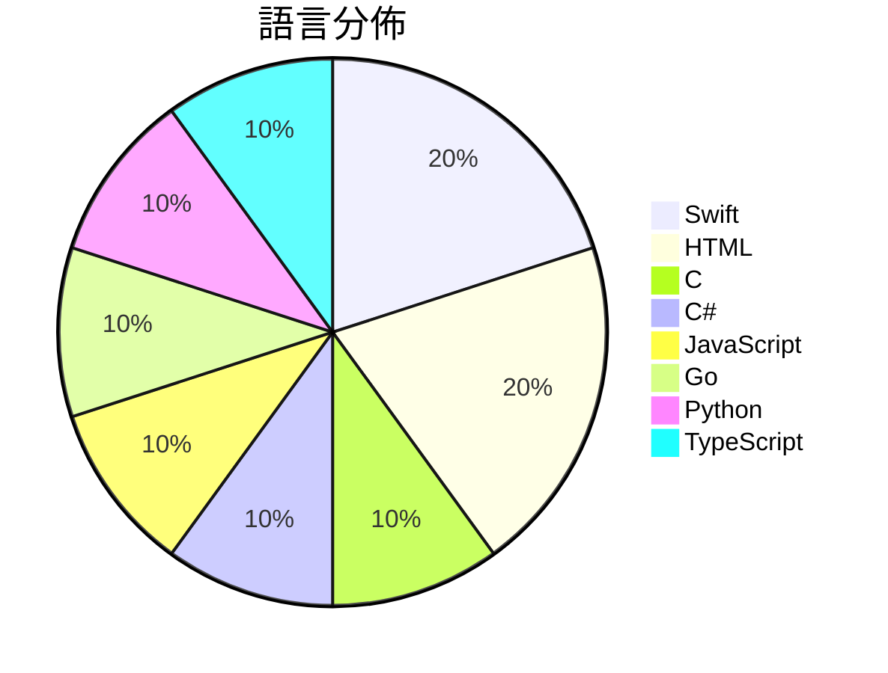

# GitHub Trending - 2026-11-13

> [!summary] 本日摘要
> 收錄 **10** 個新專案，合計 **24.5k** stars
> 語言分佈：Swift (2) · HTML (2) · C (1) · C# (1) · JavaScript (1) · Go (1) · Python (1) · TypeScript (1)

> [!tip] 本週焦點
> **[[huamidev--GestaltX|huamidev/GestaltX]]** — 4 天內累積 7.1k stars（1.8k stars/天）
> An MobileGestalt editor for iOS 27.x, featuring region-code tweaks, device presets, backups.



---

## 收錄列表

| # | 專案 | 分類 | Stars | 速度 | 安裝 | 語言 | 用途 |
| :--: | --- | --- | ---: | ---: | --- | --- | --- |
| 1 | [[huamidev--GestaltX\|huamidev/GestaltX]] |  | 7.1k | 1.8k/天 |  | Swift | An MobileGestalt editor for iOS 27.x, fe |
| 2 | [[tangerineturtle1--NX2navi\|tangerineturtle1/NX2navi]] |  | 3.6k | 730/天 |  | C |  |
| 3 | [[jhaizhou-ops--S2Arm\|jhaizhou-ops/S2Arm]] |  | 2.8k | 561/天 |  | C# | Run your own Switch games natively on iP |
| 4 | [[JenkinWoo--sheeridVerify\|JenkinWoo/sheeridVerify]] |  | 2.1k | 354/天 |  | JavaScript |  |
| 5 | [[DIYgod--pinky\|DIYgod/pinky]] |  | 2.0k | 340/天 |  | Go | Let AI agents use your phone, with you i |
| 6 | [[Kianuni--Erosion-CN\|Kianuni/Erosion-CN]] |  | 1.8k | 587/天 |  | Swift | iOS / iPadOS 系统配置与 MobileGestalt 研究工具箱（简 |
| 7 | [[HybridRobotics--supermimic\|HybridRobotics/supermimic]] |  | 1.4k | 681/天 |  | Python | Humanoid whole-body motion tracking with |
| 8 | [[agentes-chat--agentes-chat\|agentes-chat/agentes-chat]] |  | 1.2k | 312/天 |  | TypeScript | Open-source, self-hosted Slack alternati |
| 9 | [[mahmoudtawfik1998--secure-pdf-document-processor\|mahmoudtawfik1998/secure-pdf-document-processor]] |  | 1.2k | 202/天 |  | HTML | Adobe Acrobat Pro 2026: Secure Standalon |
| 10 | [[abdulmannanmalik13-wq--adobe-substance-3d-studio\|abdulmannanmalik13-wq/adobe-substance-3d-studio]] |  | 1.2k | 202/天 |  | HTML | Adobe Substance 3D Creative Studio 2026  |

---

## 重點摘要

### 1. [[huamidev--GestaltX|huamidev/GestaltX]]

**7.1k** stars · **1.8k** stars/天 · Swift

---

### 2. [[tangerineturtle1--NX2navi|tangerineturtle1/NX2navi]]

**3.6k** stars · **730** stars/天 · C

---

### 3. [[jhaizhou-ops--S2Arm|jhaizhou-ops/S2Arm]]

**2.8k** stars · **561** stars/天 · C#

---

### 4. [[JenkinWoo--sheeridVerify|JenkinWoo/sheeridVerify]]

**2.1k** stars · **354** stars/天 · JavaScript

---

### 5. [[DIYgod--pinky|DIYgod/pinky]]

**2.0k** stars · **340** stars/天 · Go

---

### 6. [[Kianuni--Erosion-CN|Kianuni/Erosion-CN]]

**1.8k** stars · **587** stars/天 · Swift

---

### 7. [[HybridRobotics--supermimic|HybridRobotics/supermimic]]

**1.4k** stars · **681** stars/天 · Python

---

### 8. [[agentes-chat--agentes-chat|agentes-chat/agentes-chat]]

**1.2k** stars · **312** stars/天 · TypeScript

---

### 9. [[mahmoudtawfik1998--secure-pdf-document-processor|mahmoudtawfik1998/secure-pdf-document-processor]]

**1.2k** stars · **202** stars/天 · HTML

---

### 10. [[abdulmannanmalik13-wq--adobe-substance-3d-studio|abdulmannanmalik13-wq/adobe-substance-3d-studio]]

**1.2k** stars · **202** stars/天 · HTML

---

## 今日到期複習

> [!tip] 根據間隔複習排程，今天該回顧的專案

```dataview
TABLE
  stars_per_day AS "Stars/天",
  category AS "分類",
  engagement AS "參與度"
FROM "Repos"
WHERE next_review AND date(next_review) <= date("2026-11-13") AND status != "archived"
SORT priority DESC
```

## 待處理

```dataviewjs
const pending = dv.pages('"Repos"').where(p => p.status === "to-review").length;
const unrated = dv.pages('"Repos"').where(p => p.status !== "archived" && p.status !== "to-review" && (p.my_rating || 0) === 0).length;
const noVerdict = dv.pages('"Repos"').where(p => p.status !== "archived" && (p.my_rating || 0) > 0 && (!p.verdict || p.verdict === "")).length;
const items = [];
if (pending > 0) items.push(`**${pending}** 個待分流`);
if (unrated > 0) items.push(`**${unrated}** 個已讀但未評分`);
if (noVerdict > 0) items.push(`**${noVerdict}** 個已評分但無結論`);
if (items.length > 0) dv.paragraph(items.join(" / "));
else dv.paragraph("所有專案都已處理完畢！");
```
