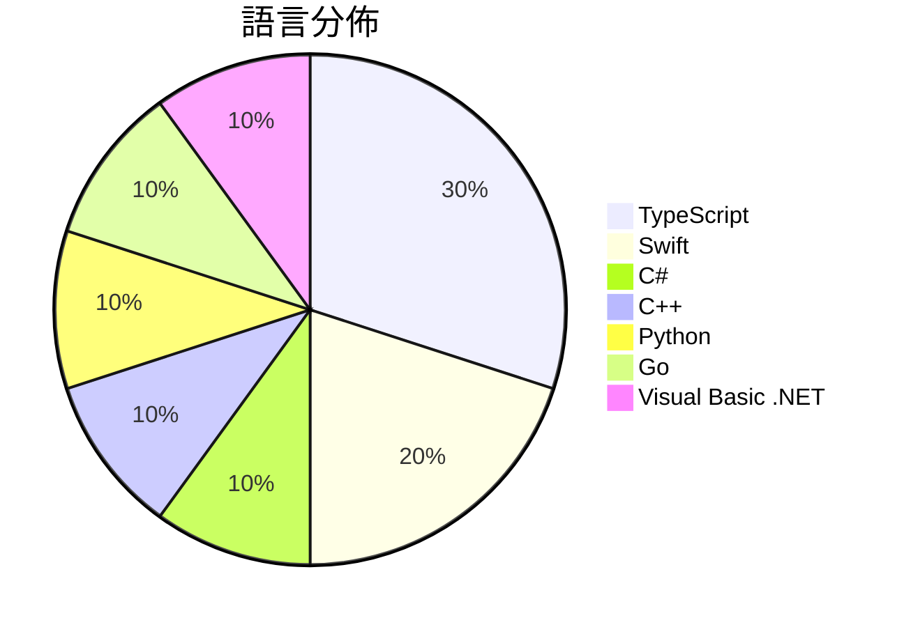

# GitHub Trending - 2026-11-15

> [!summary] 本日摘要
> 收錄 **10** 個新專案，合計 **23.3k** stars
> 語言分佈：TypeScript (3) · Swift (2) · C# (1) · C++ (1) · Python (1) · Go (1) · Visual Basic .NET (1)

> [!tip] 本週焦點
> **[[huamidev--GestaltX|huamidev/GestaltX]]** — 6 天內累積 7.6k stars（1.3k stars/天）
> An MobileGestalt editor for iOS 27.x, featuring region-code tweaks, device presets, backups.



---

## 收錄列表

| # | 專案 | 分類 | Stars | 速度 | 安裝 | 語言 | 用途 |
| :--: | --- | --- | ---: | ---: | --- | --- | --- |
| 1 | [[huamidev--GestaltX\|huamidev/GestaltX]] |  | 7.6k | 1.3k/天 |  | Swift | An MobileGestalt editor for iOS 27.x, fe |
| 2 | [[jhaizhou-ops--S2Arm\|jhaizhou-ops/S2Arm]] |  | 3.1k | 437/天 |  | C# | Run your own Switch games natively on iP |
| 3 | [[Kianuni--Erosion-CN\|Kianuni/Erosion-CN]] |  | 2.1k | 417/天 |  | Swift | iOS / iPadOS 系统配置与 MobileGestalt 研究工具箱（简 |
| 4 | [[deepseek-ai--chat-demo\|deepseek-ai/chat-demo]] |  | 1.9k | 955/天 |  | TypeScript | Chat Demo |
| 5 | [[apex-compute--ANR\|apex-compute/ANR]] |  | 1.9k | 473/天 |  | C++ | Apex Neural Rendering (ANR) by Apex Comp |
| 6 | [[FrigadeHQ--yogurt\|FrigadeHQ/yogurt]] |  | 1.5k | 382/天 |  | TypeScript | Private AI meeting notes that stay on yo |
| 7 | [[HybridRobotics--supermimic\|HybridRobotics/supermimic]] |  | 1.5k | 379/天 |  | Python | Humanoid whole-body motion tracking with |
| 8 | [[agentes-chat--agentes-chat\|agentes-chat/agentes-chat]] |  | 1.4k | 237/天 |  | TypeScript | Open-source, self-hosted Slack alternati |
| 9 | [[HolyArrs--HolyArrs\|HolyArrs/HolyArrs]] |  | 1.2k | 241/天 |  | Go | One self-hosted app for your shows, movi |
| 10 | [[DevedevT--FFmpeg-GUI-Editor-Windows\|DevedevT/FFmpeg-GUI-Editor-Windows]] |  | 1.1k | 526/天 |  | Visual Basic .NET | Lightweight portable FFmpeg GUI & lossle |

---

## 重點摘要

### 1. [[huamidev--GestaltX|huamidev/GestaltX]]

**7.6k** stars · **1.3k** stars/天 · Swift

---

### 2. [[jhaizhou-ops--S2Arm|jhaizhou-ops/S2Arm]]

**3.1k** stars · **437** stars/天 · C#

---

### 3. [[Kianuni--Erosion-CN|Kianuni/Erosion-CN]]

**2.1k** stars · **417** stars/天 · Swift

---

### 4. [[deepseek-ai--chat-demo|deepseek-ai/chat-demo]]

**1.9k** stars · **955** stars/天 · TypeScript

---

### 5. [[apex-compute--ANR|apex-compute/ANR]]

**1.9k** stars · **473** stars/天 · C++

---

### 6. [[FrigadeHQ--yogurt|FrigadeHQ/yogurt]]

**1.5k** stars · **382** stars/天 · TypeScript

---

### 7. [[HybridRobotics--supermimic|HybridRobotics/supermimic]]

**1.5k** stars · **379** stars/天 · Python

---

### 8. [[agentes-chat--agentes-chat|agentes-chat/agentes-chat]]

**1.4k** stars · **237** stars/天 · TypeScript

---

### 9. [[HolyArrs--HolyArrs|HolyArrs/HolyArrs]]

**1.2k** stars · **241** stars/天 · Go

---

### 10. [[DevedevT--FFmpeg-GUI-Editor-Windows|DevedevT/FFmpeg-GUI-Editor-Windows]]

**1.1k** stars · **526** stars/天 · Visual Basic .NET

---

## 今日到期複習

> [!tip] 根據間隔複習排程，今天該回顧的專案

```dataview
TABLE
  stars_per_day AS "Stars/天",
  category AS "分類",
  engagement AS "參與度"
FROM "Repos"
WHERE next_review AND date(next_review) <= date("2026-11-15") AND status != "archived"
SORT priority DESC
```

## 待處理

```dataviewjs
const pending = dv.pages('"Repos"').where(p => p.status === "to-review").length;
const unrated = dv.pages('"Repos"').where(p => p.status !== "archived" && p.status !== "to-review" && (p.my_rating || 0) === 0).length;
const noVerdict = dv.pages('"Repos"').where(p => p.status !== "archived" && (p.my_rating || 0) > 0 && (!p.verdict || p.verdict === "")).length;
const items = [];
if (pending > 0) items.push(`**${pending}** 個待分流`);
if (unrated > 0) items.push(`**${unrated}** 個已讀但未評分`);
if (noVerdict > 0) items.push(`**${noVerdict}** 個已評分但無結論`);
if (items.length > 0) dv.paragraph(items.join(" / "));
else dv.paragraph("所有專案都已處理完畢！");
```
