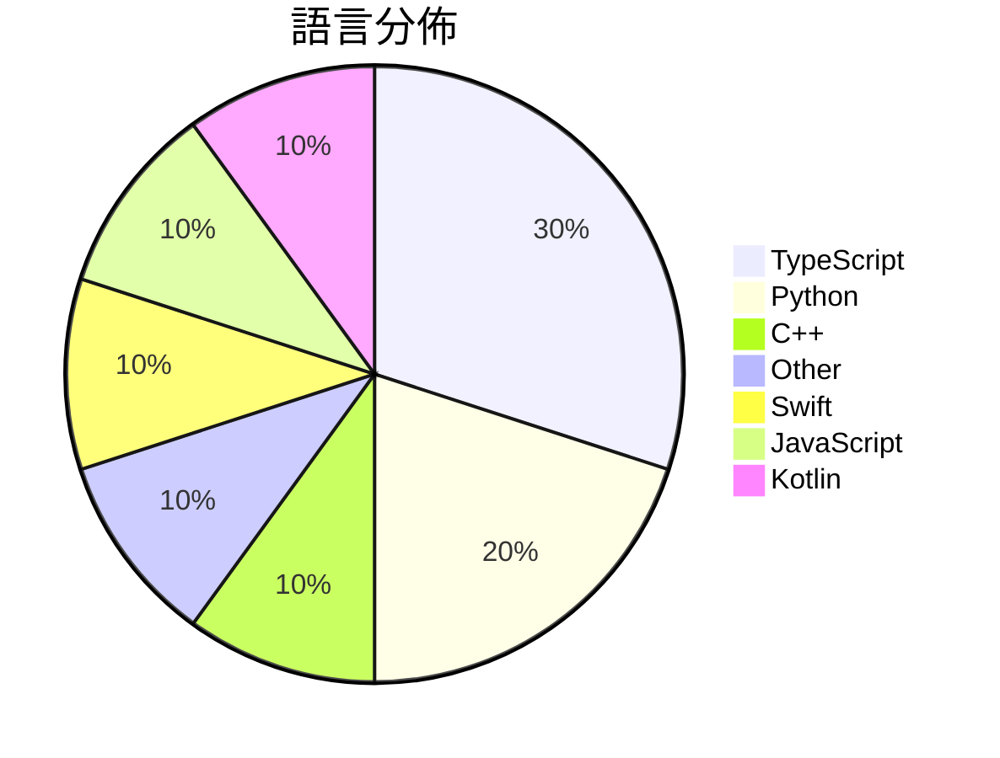

# GitHub Trending - 2026-11-17

> [!summary] 本日摘要
> 收錄 **10** 個新專案，合計 **21.1k** stars
> 語言分佈：TypeScript (3) · Python (2) · C++ (1) · Other (1) · Swift (1) · JavaScript (1) · Kotlin (1)

> [!tip] 本週焦點
> **[[deepseek-ai--chat-demo|deepseek-ai/chat-demo]]** — 5 天內累積 4.3k stars（863 stars/天）
> Chat Demo



---

## 收錄列表

| # | 專案 | 分類 | Stars | 速度 | 安裝 | 語言 | 用途 |
| :--: | --- | --- | ---: | ---: | --- | --- | --- |
| 1 | [[deepseek-ai--chat-demo\|deepseek-ai/chat-demo]] |  | 4.3k | 863/天 |  | TypeScript | Chat Demo |
| 2 | [[apex-compute--ANR\|apex-compute/ANR]] |  | 2.5k | 420/天 |  | C++ | Apex Neural Rendering (ANR) by Apex Comp |
| 3 | [[hitkeeen--blender-ai-mcp-addon\|hitkeeen/blender-ai-mcp-addon]] |  | 2.3k | 583/天 |  | N/A | AI assistant and MCP server for Blender: |
| 4 | [[Kianuni--Erosion-CN\|Kianuni/Erosion-CN]] |  | 2.2k | 317/天 |  | Swift | iOS / iPadOS 系统配置与 MobileGestalt 研究工具箱（中 |
| 5 | [[FrigadeHQ--yogurt\|FrigadeHQ/yogurt]] |  | 1.9k | 321/天 |  | TypeScript | Private AI meeting notes that stay on yo |
| 6 | [[Noniv--abyssal-garden\|Noniv/abyssal-garden]] |  | 1.9k | 473/天 |  | JavaScript | A dreamy underwater world you can swim t |
| 7 | [[HybridRobotics--supermimic\|HybridRobotics/supermimic]] |  | 1.7k | 284/天 |  | Python | Humanoid whole-body motion tracking with |
| 8 | [[duwqijlk--muse-protocol\|duwqijlk/muse-protocol]] |  | 1.5k | 508/天 |  | Python | muse.ai 注册与邀请码兑换协议研究（纯 HTTP Python 实现） |
| 9 | [[Eynnzerr--TelemetryCleaner\|Eynnzerr/TelemetryCleaner]] |  | 1.4k | 232/天 |  | Kotlin | 基于 Shizuku 免 Root 清除国产安卓 SystemHelper、Re |
| 10 | [[ZiChuanLan--freebie-radar\|ZiChuanLan/freebie-radar]] |  | 1.3k | 321/天 |  | TypeScript | 白嫖与资讯资源聚合雷达：100+个源定时采集 + AI 二审过滤假福利 + 获取 |

---

## 重點摘要

### 1. [[deepseek-ai--chat-demo|deepseek-ai/chat-demo]]

**4.3k** stars · **863** stars/天 · TypeScript

---

### 2. [[apex-compute--ANR|apex-compute/ANR]]

**2.5k** stars · **420** stars/天 · C++

---

### 3. [[hitkeeen--blender-ai-mcp-addon|hitkeeen/blender-ai-mcp-addon]]

**2.3k** stars · **583** stars/天 · N/A

---

### 4. [[Kianuni--Erosion-CN|Kianuni/Erosion-CN]]

**2.2k** stars · **317** stars/天 · Swift

---

### 5. [[FrigadeHQ--yogurt|FrigadeHQ/yogurt]]

**1.9k** stars · **321** stars/天 · TypeScript

---

### 6. [[Noniv--abyssal-garden|Noniv/abyssal-garden]]

**1.9k** stars · **473** stars/天 · JavaScript

---

### 7. [[HybridRobotics--supermimic|HybridRobotics/supermimic]]

**1.7k** stars · **284** stars/天 · Python

---

### 8. [[duwqijlk--muse-protocol|duwqijlk/muse-protocol]]

**1.5k** stars · **508** stars/天 · Python

---

### 9. [[Eynnzerr--TelemetryCleaner|Eynnzerr/TelemetryCleaner]]

**1.4k** stars · **232** stars/天 · Kotlin

---

### 10. [[ZiChuanLan--freebie-radar|ZiChuanLan/freebie-radar]]

**1.3k** stars · **321** stars/天 · TypeScript

---

## 今日到期複習

> [!tip] 根據間隔複習排程，今天該回顧的專案

```dataview
TABLE
  stars_per_day AS "Stars/天",
  category AS "分類",
  engagement AS "參與度"
FROM "Repos"
WHERE next_review AND date(next_review) <= date("2026-11-17") AND status != "archived"
SORT priority DESC
```

## 待處理

```dataviewjs
const pending = dv.pages('"Repos"').where(p => p.status === "to-review").length;
const unrated = dv.pages('"Repos"').where(p => p.status !== "archived" && p.status !== "to-review" && (p.my_rating || 0) === 0).length;
const noVerdict = dv.pages('"Repos"').where(p => p.status !== "archived" && (p.my_rating || 0) > 0 && (!p.verdict || p.verdict === "")).length;
const items = [];
if (pending > 0) items.push(`**${pending}** 個待分流`);
if (unrated > 0) items.push(`**${unrated}** 個已讀但未評分`);
if (noVerdict > 0) items.push(`**${noVerdict}** 個已評分但無結論`);
if (items.length > 0) dv.paragraph(items.join(" / "));
else dv.paragraph("所有專案都已處理完畢！");
```
