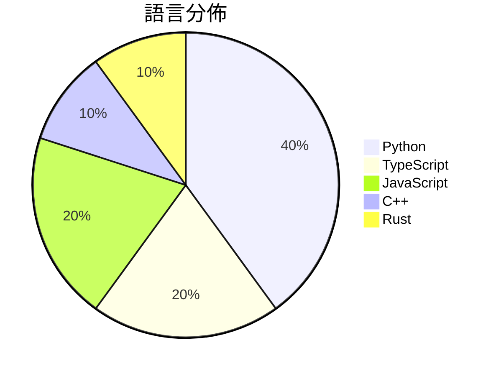

# GitHub Trending - 2026-11-19

> [!summary] 本日摘要
> 收錄 **10** 個新專案，合計 **25.2k** stars
> 語言分佈：Python (4) · TypeScript (2) · JavaScript (2) · C++ (1) · Rust (1)

> [!tip] 本週焦點
> **[[deepseek-ai--chat-demo|deepseek-ai/chat-demo]]** — 7 天內累積 4.9k stars（704 stars/天）
> Chat Demo



---

## 收錄列表

| # | 專案 | 分類 | Stars | 速度 | 安裝 | 語言 | 用途 |
| :--: | --- | --- | ---: | ---: | --- | --- | --- |
| 1 | [[deepseek-ai--chat-demo\|deepseek-ai/chat-demo]] |  | 4.9k | 704/天 |  | TypeScript | Chat Demo |
| 2 | [[krisgfx9--Wireless-Device-Battery-Monitor\|krisgfx9/Wireless-Device-Battery-Monitor]] |  | 4.2k | 2.1k/天 |  | C++ | Show the battery level of wireless mice, |
| 3 | [[erkamyaman--rust-anything\|erkamyaman/rust-anything]] |  | 3.9k | 2.0k/天 |  | Rust | Rewrite your whole app in Rust, one piec |
| 4 | [[Noniv--abyssal-garden\|Noniv/abyssal-garden]] |  | 2.4k | 406/天 |  | JavaScript | A dreamy underwater world you can swim t |
| 5 | [[Immortal-Protocols--lastbook\|Immortal-Protocols/lastbook]] |  | 2.2k | 372/天 |  | Python | Offline knowledge AI, maps and videos fo |
| 6 | [[ZiChuanLan--freebie-radar\|ZiChuanLan/freebie-radar]] |  | 1.7k | 283/天 |  | TypeScript | 白嫖与资讯资源聚合雷达：100+个源定时采集 + AI 二审过滤假福利 + 获取 |
| 7 | [[duwqijlk--muse-protocol\|duwqijlk/muse-protocol]] |  | 1.6k | 327/天 |  | Python | muse.ai 注册与邀请码兑换协议研究（纯 HTTP Python 实现） |
| 8 | [[Hut-hzf--ung220z-tool\|Hut-hzf/ung220z-tool]] |  | 1.5k | 501/天 |  | Python | ung220z-tool 是一个针对 UNG220Z（九联/Unionman 中 |
| 9 | [[CzzzzzzJ--mdldm-maitian\|CzzzzzzJ/mdldm-maitian]] |  | 1.5k | 292/天 |  | JavaScript | 麦田：自媒体多平台发布中控与数据监控（B站/抖音/小红书/视频号/YouTube |
| 10 | [[sybil-solutions--inference-optimisation-skill\|sybil-solutions/inference-optimisation-skill]] |  | 1.2k | 584/天 |  | Python | Agent skill for hill-climbing local LLM  |

---

## 重點摘要

### 1. [[deepseek-ai--chat-demo|deepseek-ai/chat-demo]]

**4.9k** stars · **704** stars/天 · TypeScript

---

### 2. [[krisgfx9--Wireless-Device-Battery-Monitor|krisgfx9/Wireless-Device-Battery-Monitor]]

**4.2k** stars · **2.1k** stars/天 · C++

---

### 3. [[erkamyaman--rust-anything|erkamyaman/rust-anything]]

**3.9k** stars · **2.0k** stars/天 · Rust

---

### 4. [[Noniv--abyssal-garden|Noniv/abyssal-garden]]

**2.4k** stars · **406** stars/天 · JavaScript

---

### 5. [[Immortal-Protocols--lastbook|Immortal-Protocols/lastbook]]

**2.2k** stars · **372** stars/天 · Python

---

### 6. [[ZiChuanLan--freebie-radar|ZiChuanLan/freebie-radar]]

**1.7k** stars · **283** stars/天 · TypeScript

---

### 7. [[duwqijlk--muse-protocol|duwqijlk/muse-protocol]]

**1.6k** stars · **327** stars/天 · Python

---

### 8. [[Hut-hzf--ung220z-tool|Hut-hzf/ung220z-tool]]

**1.5k** stars · **501** stars/天 · Python

---

### 9. [[CzzzzzzJ--mdldm-maitian|CzzzzzzJ/mdldm-maitian]]

**1.5k** stars · **292** stars/天 · JavaScript

---

### 10. [[sybil-solutions--inference-optimisation-skill|sybil-solutions/inference-optimisation-skill]]

**1.2k** stars · **584** stars/天 · Python

---

## 今日到期複習

> [!tip] 根據間隔複習排程，今天該回顧的專案

```dataview
TABLE
  stars_per_day AS "Stars/天",
  category AS "分類",
  engagement AS "參與度"
FROM "Repos"
WHERE next_review AND date(next_review) <= date("2026-11-19") AND status != "archived"
SORT priority DESC
```

## 待處理

```dataviewjs
const pending = dv.pages('"Repos"').where(p => p.status === "to-review").length;
const unrated = dv.pages('"Repos"').where(p => p.status !== "archived" && p.status !== "to-review" && (p.my_rating || 0) === 0).length;
const noVerdict = dv.pages('"Repos"').where(p => p.status !== "archived" && (p.my_rating || 0) > 0 && (!p.verdict || p.verdict === "")).length;
const items = [];
if (pending > 0) items.push(`**${pending}** 個待分流`);
if (unrated > 0) items.push(`**${unrated}** 個已讀但未評分`);
if (noVerdict > 0) items.push(`**${noVerdict}** 個已評分但無結論`);
if (items.length > 0) dv.paragraph(items.join(" / "));
else dv.paragraph("所有專案都已處理完畢！");
```
