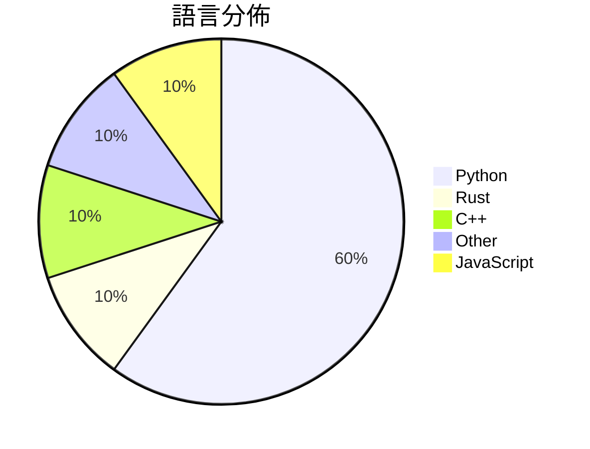

# GitHub Trending - 2026-11-21

> [!summary] 本日摘要
> 收錄 **10** 個新專案，合計 **26.7k** stars
> 語言分佈：Python (6) · Rust (1) · C++ (1) · Other (1) · JavaScript (1)

> [!tip] 本週焦點
> **[[erkamyaman--rust-anything|erkamyaman/rust-anything]]** — 4 天內累積 6.9k stars（1.7k stars/天）
> Rewrite your whole app in Rust, one piece at a time, checked against the original's recorded behavior at every step. CLIs, HTTP servers and libraries in TypeScript, Python, C, Go, Ruby and Java.



---

## 收錄列表

| # | 專案 | 分類 | Stars | 速度 | 安裝 | 語言 | 用途 |
| :--: | --- | --- | ---: | ---: | --- | --- | --- |
| 1 | [[erkamyaman--rust-anything\|erkamyaman/rust-anything]] |  | 6.9k | 1.7k/天 |  | Rust | Rewrite your whole app in Rust, one piec |
| 2 | [[krisgfx9--Wireless-Device-Battery-Monitor\|krisgfx9/Wireless-Device-Battery-Monitor]] |  | 5.5k | 1.4k/天 |  | C++ | Show the battery level of wireless mice, |
| 3 | [[gylive--google-ultra\|gylive/google-ultra]] |  | 2.6k | 851/天 |  | Python |  |
| 4 | [[Hut-hzf--ung220z-tool\|Hut-hzf/ung220z-tool]] |  | 2.1k | 420/天 |  | Python | ung220z-tool 是一个针对 UNG220Z（九联/Unionman 中 |
| 5 | [[bookwjitchieni1986--blender-ai-mcp-addon\|bookwjitchieni1986/blender-ai-mcp-addon]] |  | 1.9k | 1.9k/天 |  | N/A | AI assistant and MCP server for Blender: |
| 6 | [[CzzzzzzJ--mdldm-maitian\|CzzzzzzJ/mdldm-maitian]] |  | 1.7k | 249/天 |  | JavaScript | 麦田：自媒体多平台发布中控与数据监控（B站/抖音/小红书/视频号/YouTube |
| 7 | [[duwqijlk--muse-protocol\|duwqijlk/muse-protocol]] |  | 1.7k | 244/天 |  | Python | muse.ai 注册与邀请码兑换协议研究（纯 HTTP Python 实现） |
| 8 | [[haziqahmedqasmi--PeakCut\|haziqahmedqasmi/PeakCut]] |  | 1.6k | 224/天 |  | Python | AI clipping for long videos and live str |
| 9 | [[iamajmeena--neonclipping\|iamajmeena/neonclipping]] |  | 1.4k | 1.4k/天 |  | Python | Paste a link, get captioned 9:16 clips i |
| 10 | [[sybil-solutions--inference-optimisation-skill\|sybil-solutions/inference-optimisation-skill]] |  | 1.4k | 346/天 |  | Python | Agent skill for hill-climbing local LLM  |

---

## 重點摘要

### 1. [[erkamyaman--rust-anything|erkamyaman/rust-anything]]

**6.9k** stars · **1.7k** stars/天 · Rust

---

### 2. [[krisgfx9--Wireless-Device-Battery-Monitor|krisgfx9/Wireless-Device-Battery-Monitor]]

**5.5k** stars · **1.4k** stars/天 · C++

---

### 3. [[gylive--google-ultra|gylive/google-ultra]]

**2.6k** stars · **851** stars/天 · Python

---

### 4. [[Hut-hzf--ung220z-tool|Hut-hzf/ung220z-tool]]

**2.1k** stars · **420** stars/天 · Python

---

### 5. [[bookwjitchieni1986--blender-ai-mcp-addon|bookwjitchieni1986/blender-ai-mcp-addon]]

**1.9k** stars · **1.9k** stars/天 · N/A

---

### 6. [[CzzzzzzJ--mdldm-maitian|CzzzzzzJ/mdldm-maitian]]

**1.7k** stars · **249** stars/天 · JavaScript

---

### 7. [[duwqijlk--muse-protocol|duwqijlk/muse-protocol]]

**1.7k** stars · **244** stars/天 · Python

---

### 8. [[haziqahmedqasmi--PeakCut|haziqahmedqasmi/PeakCut]]

**1.6k** stars · **224** stars/天 · Python

---

### 9. [[iamajmeena--neonclipping|iamajmeena/neonclipping]]

**1.4k** stars · **1.4k** stars/天 · Python

---

### 10. [[sybil-solutions--inference-optimisation-skill|sybil-solutions/inference-optimisation-skill]]

**1.4k** stars · **346** stars/天 · Python

---

## 今日到期複習

> [!tip] 根據間隔複習排程，今天該回顧的專案

```dataview
TABLE
  stars_per_day AS "Stars/天",
  category AS "分類",
  engagement AS "參與度"
FROM "Repos"
WHERE next_review AND date(next_review) <= date("2026-11-21") AND status != "archived"
SORT priority DESC
```

## 待處理

```dataviewjs
const pending = dv.pages('"Repos"').where(p => p.status === "to-review").length;
const unrated = dv.pages('"Repos"').where(p => p.status !== "archived" && p.status !== "to-review" && (p.my_rating || 0) === 0).length;
const noVerdict = dv.pages('"Repos"').where(p => p.status !== "archived" && (p.my_rating || 0) > 0 && (!p.verdict || p.verdict === "")).length;
const items = [];
if (pending > 0) items.push(`**${pending}** 個待分流`);
if (unrated > 0) items.push(`**${unrated}** 個已讀但未評分`);
if (noVerdict > 0) items.push(`**${noVerdict}** 個已評分但無結論`);
if (items.length > 0) dv.paragraph(items.join(" / "));
else dv.paragraph("所有專案都已處理完畢！");
```
