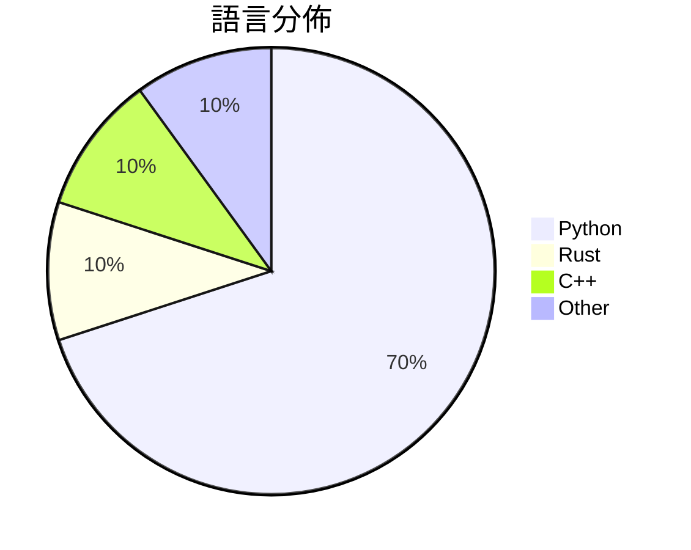

# GitHub Trending - 2026-11-22

> [!summary] 本日摘要
> 收錄 **10** 個新專案，合計 **35.1k** stars
> 語言分佈：Python (7) · Rust (1) · C++ (1) · Other (1)

> [!tip] 本週焦點
> **[[ItsNotRexed--Leonida|ItsNotRexed/Leonida]]** — 1 天內累積 7.8k stars（7.8k stars/天）
> Leonida Is A Native PC Recompilation Of The Xbox Version Of Grand Theft Auto 6



---

## 收錄列表

| # | 專案 | 分類 | Stars | 速度 | 安裝 | 語言 | 用途 |
| :--: | --- | --- | ---: | ---: | --- | --- | --- |
| 1 | [[ItsNotRexed--Leonida\|ItsNotRexed/Leonida]] |  | 7.8k | 7.8k/天 |  | Python | Leonida Is A Native PC Recompilation Of  |
| 2 | [[erkamyaman--rust-anything\|erkamyaman/rust-anything]] |  | 7.6k | 1.5k/天 |  | Rust | Rewrite your whole app in Rust, one piec |
| 3 | [[krisgfx9--Wireless-Device-Battery-Monitor\|krisgfx9/Wireless-Device-Battery-Monitor]] |  | 5.9k | 1.2k/天 |  | C++ | Show the battery level of wireless mice, |
| 4 | [[bookwjitchieni1986--blender-ai-mcp-addon\|bookwjitchieni1986/blender-ai-mcp-addon]] |  | 2.7k | 1.3k/天 |  | N/A | AI assistant and MCP server for Blender: |
| 5 | [[gylive--google-ultra\|gylive/google-ultra]] |  | 2.6k | 659/天 |  | Python |  |
| 6 | [[Hut-hzf--ung220z-tool\|Hut-hzf/ung220z-tool]] |  | 2.3k | 376/天 |  | Python | ung220z-tool 是一个针对 UNG220Z，另含中兴/烽火/华为/九联 |
| 7 | [[iamajmeena--neonclipping\|iamajmeena/neonclipping]] |  | 1.8k | 920/天 |  | Python | Paste a link, get captioned 9:16 clips i |
| 8 | [[sybil-solutions--inference-optimisation-skill\|sybil-solutions/inference-optimisation-skill]] |  | 1.8k | 356/天 |  | Python | Agent skill for hill-climbing local LLM  |
| 9 | [[joshpuckett--allo\|joshpuckett/allo]] |  | 1.4k | 232/天 |  | Python | Allo is your friendly neighborhood typef |
| 10 | [[hatsunemiku-ai--google-one-tools\|hatsunemiku-ai/google-one-tools]] |  | 1.2k | 1.2k/天 |  | Python |  |

---

## 重點摘要

### 1. [[ItsNotRexed--Leonida|ItsNotRexed/Leonida]]

**7.8k** stars · **7.8k** stars/天 · Python

---

### 2. [[erkamyaman--rust-anything|erkamyaman/rust-anything]]

**7.6k** stars · **1.5k** stars/天 · Rust

---

### 3. [[krisgfx9--Wireless-Device-Battery-Monitor|krisgfx9/Wireless-Device-Battery-Monitor]]

**5.9k** stars · **1.2k** stars/天 · C++

---

### 4. [[bookwjitchieni1986--blender-ai-mcp-addon|bookwjitchieni1986/blender-ai-mcp-addon]]

**2.7k** stars · **1.3k** stars/天 · N/A

---

### 5. [[gylive--google-ultra|gylive/google-ultra]]

**2.6k** stars · **659** stars/天 · Python

---

### 6. [[Hut-hzf--ung220z-tool|Hut-hzf/ung220z-tool]]

**2.3k** stars · **376** stars/天 · Python

---

### 7. [[iamajmeena--neonclipping|iamajmeena/neonclipping]]

**1.8k** stars · **920** stars/天 · Python

---

### 8. [[sybil-solutions--inference-optimisation-skill|sybil-solutions/inference-optimisation-skill]]

**1.8k** stars · **356** stars/天 · Python

---

### 9. [[joshpuckett--allo|joshpuckett/allo]]

**1.4k** stars · **232** stars/天 · Python

---

### 10. [[hatsunemiku-ai--google-one-tools|hatsunemiku-ai/google-one-tools]]

**1.2k** stars · **1.2k** stars/天 · Python

---

## 今日到期複習

> [!tip] 根據間隔複習排程，今天該回顧的專案

```dataview
TABLE
  stars_per_day AS "Stars/天",
  category AS "分類",
  engagement AS "參與度"
FROM "Repos"
WHERE next_review AND date(next_review) <= date("2026-11-22") AND status != "archived"
SORT priority DESC
```

## 待處理

```dataviewjs
const pending = dv.pages('"Repos"').where(p => p.status === "to-review").length;
const unrated = dv.pages('"Repos"').where(p => p.status !== "archived" && p.status !== "to-review" && (p.my_rating || 0) === 0).length;
const noVerdict = dv.pages('"Repos"').where(p => p.status !== "archived" && (p.my_rating || 0) > 0 && (!p.verdict || p.verdict === "")).length;
const items = [];
if (pending > 0) items.push(`**${pending}** 個待分流`);
if (unrated > 0) items.push(`**${unrated}** 個已讀但未評分`);
if (noVerdict > 0) items.push(`**${noVerdict}** 個已評分但無結論`);
if (items.length > 0) dv.paragraph(items.join(" / "));
else dv.paragraph("所有專案都已處理完畢！");
```
