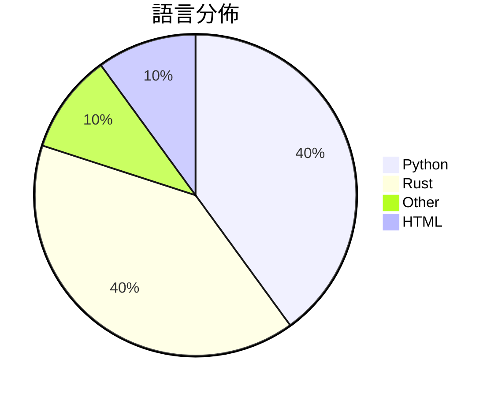

# GitHub Trending - 2026-11-23

> [!summary] 本日摘要
> 收錄 **10** 個新專案，合計 **40.3k** stars
> 語言分佈：Python (4) · Rust (4) · Other (1) · HTML (1)

> [!tip] 本週焦點
> **[[ItsNotRexed--Leonida|ItsNotRexed/Leonida]]** — 2 天內累積 17.5k stars（8.8k stars/天）
> Leonida Is A Native PC Recompilation Of The Xbox Version Of Grand Theft Auto 6



---

## 收錄列表

| # | 專案 | 分類 | Stars | 速度 | 安裝 | 語言 | 用途 |
| :--: | --- | --- | ---: | ---: | --- | --- | --- |
| 1 | [[ItsNotRexed--Leonida\|ItsNotRexed/Leonida]] |  | 17.5k | 8.8k/天 |  | Python | Leonida Is A Native PC Recompilation Of  |
| 2 | [[erkamyaman--rust-anything\|erkamyaman/rust-anything]] |  | 8.2k | 1.4k/天 |  | Rust | Rewrite your whole app in Rust, one piec |
| 3 | [[bookwjitchieni1986--blender-ai-mcp-addon\|bookwjitchieni1986/blender-ai-mcp-addon]] |  | 2.8k | 919/天 |  | N/A | AI assistant and MCP server for Blender: |
| 4 | [[EL4CTEO--fast-anything\|EL4CTEO/fast-anything]] |  | 2.4k | 2.4k/天 |  | Rust | Don't rewrite it in Rust. Rewrite the 5% |
| 5 | [[iamajmeena--neonclipping\|iamajmeena/neonclipping]] |  | 2.2k | 729/天 |  | Python | Paste a link, get captioned 9:16 clips i |
| 6 | [[sybil-solutions--inference-optimisation-skill\|sybil-solutions/inference-optimisation-skill]] |  | 2.0k | 335/天 |  | Python | Agent skill for hill-climbing local LLM  |
| 7 | [[omonkeyz--xbox-emulator\|omonkeyz/xbox-emulator]] |  | 1.4k | 710/天 |  | Rust | Progress notes for running Xbox Series X |
| 8 | [[R0Y00--Xbox2Windows\|R0Y00/Xbox2Windows]] |  | 1.4k | 683/天 |  | Python | GTA VI static recompilation research for |
| 9 | [[Lemxy--WinRust\|Lemxy/WinRust]] |  | 1.3k | 259/天 |  | Rust | Windows shell replacement in Rust: taskb |
| 10 | [[chuanqisun--spaceship\|chuanqisun/spaceship]] |  | 1.1k | 176/天 |  | HTML | Steer ideas like a space pilot! |

---

## 重點摘要

### 1. [[ItsNotRexed--Leonida|ItsNotRexed/Leonida]]

**17.5k** stars · **8.8k** stars/天 · Python

---

### 2. [[erkamyaman--rust-anything|erkamyaman/rust-anything]]

**8.2k** stars · **1.4k** stars/天 · Rust

---

### 3. [[bookwjitchieni1986--blender-ai-mcp-addon|bookwjitchieni1986/blender-ai-mcp-addon]]

**2.8k** stars · **919** stars/天 · N/A

---

### 4. [[EL4CTEO--fast-anything|EL4CTEO/fast-anything]]

**2.4k** stars · **2.4k** stars/天 · Rust

---

### 5. [[iamajmeena--neonclipping|iamajmeena/neonclipping]]

**2.2k** stars · **729** stars/天 · Python

---

### 6. [[sybil-solutions--inference-optimisation-skill|sybil-solutions/inference-optimisation-skill]]

**2.0k** stars · **335** stars/天 · Python

---

### 7. [[omonkeyz--xbox-emulator|omonkeyz/xbox-emulator]]

**1.4k** stars · **710** stars/天 · Rust

---

### 8. [[R0Y00--Xbox2Windows|R0Y00/Xbox2Windows]]

**1.4k** stars · **683** stars/天 · Python

---

### 9. [[Lemxy--WinRust|Lemxy/WinRust]]

**1.3k** stars · **259** stars/天 · Rust

---

### 10. [[chuanqisun--spaceship|chuanqisun/spaceship]]

**1.1k** stars · **176** stars/天 · HTML

---

## 今日到期複習

> [!tip] 根據間隔複習排程，今天該回顧的專案

```dataview
TABLE
  stars_per_day AS "Stars/天",
  category AS "分類",
  engagement AS "參與度"
FROM "Repos"
WHERE next_review AND date(next_review) <= date("2026-11-23") AND status != "archived"
SORT priority DESC
```

## 待處理

```dataviewjs
const pending = dv.pages('"Repos"').where(p => p.status === "to-review").length;
const unrated = dv.pages('"Repos"').where(p => p.status !== "archived" && p.status !== "to-review" && (p.my_rating || 0) === 0).length;
const noVerdict = dv.pages('"Repos"').where(p => p.status !== "archived" && (p.my_rating || 0) > 0 && (!p.verdict || p.verdict === "")).length;
const items = [];
if (pending > 0) items.push(`**${pending}** 個待分流`);
if (unrated > 0) items.push(`**${unrated}** 個已讀但未評分`);
if (noVerdict > 0) items.push(`**${noVerdict}** 個已評分但無結論`);
if (items.length > 0) dv.paragraph(items.join(" / "));
else dv.paragraph("所有專案都已處理完畢！");
```
