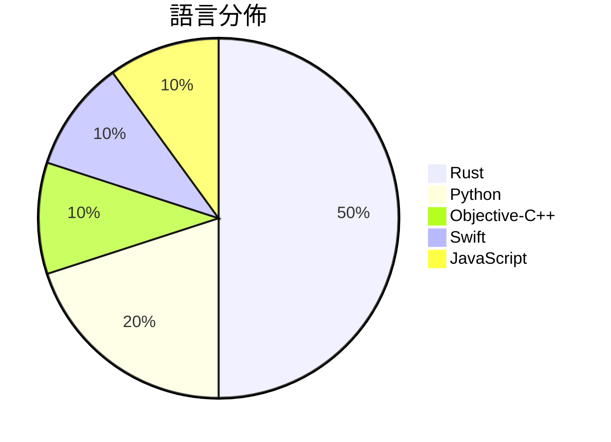

# GitHub Trending - 2026-11-24

> [!summary] 本日摘要
> 收錄 **10** 個新專案，合計 **30.0k** stars
> 語言分佈：Rust (5) · Python (2) · Objective-C++ (1) · Swift (1) · JavaScript (1)

> [!tip] 本週焦點
> **[[Marvisak--VIctory|Marvisak/VIctory]]** — 1 天內累積 7.5k stars（7.5k stars/天）
> An attempt at running GTA VI on PC



---

## 收錄列表

| # | 專案 | 分類 | Stars | 速度 | 安裝 | 語言 | 用途 |
| :--: | --- | --- | ---: | ---: | --- | --- | --- |
| 1 | [[Marvisak--VIctory\|Marvisak/VIctory]] |  | 7.5k | 7.5k/天 |  | Rust | An attempt at running GTA VI on PC |
| 2 | [[ivall--xcl\|ivall/xcl]] |  | 6.0k | 2.0k/天 |  | Rust | Xbox Series compatibility layer for Wind |
| 3 | [[EL4CTEO--fast-anything\|EL4CTEO/fast-anything]] |  | 3.4k | 1.7k/天 |  | Rust | Don't rewrite it in Rust. Rewrite the 5% |
| 4 | [[AFK-surf--xnulinux\|AFK-surf/xnulinux]] |  | 2.8k | 690/天 |  | Objective-C++ | XNU as a loadable kernel module inside L |
| 5 | [[iamajmeena--neonclipping\|iamajmeena/neonclipping]] |  | 2.4k | 474/天 |  | Python | Paste a link, get captioned 9:16 clips i |
| 6 | [[R0Y00--Xbox2Windows\|R0Y00/Xbox2Windows]] |  | 1.8k | 584/天 |  | Python | Static recompilation research for Xbox S |
| 7 | [[omonkeyz--xbox-emulator\|omonkeyz/xbox-emulator]] |  | 1.7k | 579/天 |  | Rust | Progress notes for running Xbox Series X |
| 8 | [[os6--nospeaker\|os6/nospeaker]] |  | 1.6k | 1.6k/天 |  | Swift | make your macbook's trackpad talk using  |
| 9 | [[4lwayz--portwatch-vi\|4lwayz/portwatch-vi]] |  | 1.5k | 743/天 |  | JavaScript | Does GTA VI run on PC yet? A live tracke |
| 10 | [[Lemxy--WinRust\|Lemxy/WinRust]] |  | 1.4k | 238/天 |  | Rust | Windows shell replacement in Rust: taskb |

---

## 重點摘要

### 1. [[Marvisak--VIctory|Marvisak/VIctory]]

**7.5k** stars · **7.5k** stars/天 · Rust

---

### 2. [[ivall--xcl|ivall/xcl]]

**6.0k** stars · **2.0k** stars/天 · Rust

---

### 3. [[EL4CTEO--fast-anything|EL4CTEO/fast-anything]]

**3.4k** stars · **1.7k** stars/天 · Rust

---

### 4. [[AFK-surf--xnulinux|AFK-surf/xnulinux]]

**2.8k** stars · **690** stars/天 · Objective-C++

---

### 5. [[iamajmeena--neonclipping|iamajmeena/neonclipping]]

**2.4k** stars · **474** stars/天 · Python

---

### 6. [[R0Y00--Xbox2Windows|R0Y00/Xbox2Windows]]

**1.8k** stars · **584** stars/天 · Python

---

### 7. [[omonkeyz--xbox-emulator|omonkeyz/xbox-emulator]]

**1.7k** stars · **579** stars/天 · Rust

---

### 8. [[os6--nospeaker|os6/nospeaker]]

**1.6k** stars · **1.6k** stars/天 · Swift

---

### 9. [[4lwayz--portwatch-vi|4lwayz/portwatch-vi]]

**1.5k** stars · **743** stars/天 · JavaScript

---

### 10. [[Lemxy--WinRust|Lemxy/WinRust]]

**1.4k** stars · **238** stars/天 · Rust

---

## 今日到期複習

> [!tip] 根據間隔複習排程，今天該回顧的專案

```dataview
TABLE
  stars_per_day AS "Stars/天",
  category AS "分類",
  engagement AS "參與度"
FROM "Repos"
WHERE next_review AND date(next_review) <= date("2026-11-24") AND status != "archived"
SORT priority DESC
```

## 待處理

```dataviewjs
const pending = dv.pages('"Repos"').where(p => p.status === "to-review").length;
const unrated = dv.pages('"Repos"').where(p => p.status !== "archived" && p.status !== "to-review" && (p.my_rating || 0) === 0).length;
const noVerdict = dv.pages('"Repos"').where(p => p.status !== "archived" && (p.my_rating || 0) > 0 && (!p.verdict || p.verdict === "")).length;
const items = [];
if (pending > 0) items.push(`**${pending}** 個待分流`);
if (unrated > 0) items.push(`**${unrated}** 個已讀但未評分`);
if (noVerdict > 0) items.push(`**${noVerdict}** 個已評分但無結論`);
if (items.length > 0) dv.paragraph(items.join(" / "));
else dv.paragraph("所有專案都已處理完畢！");
```
