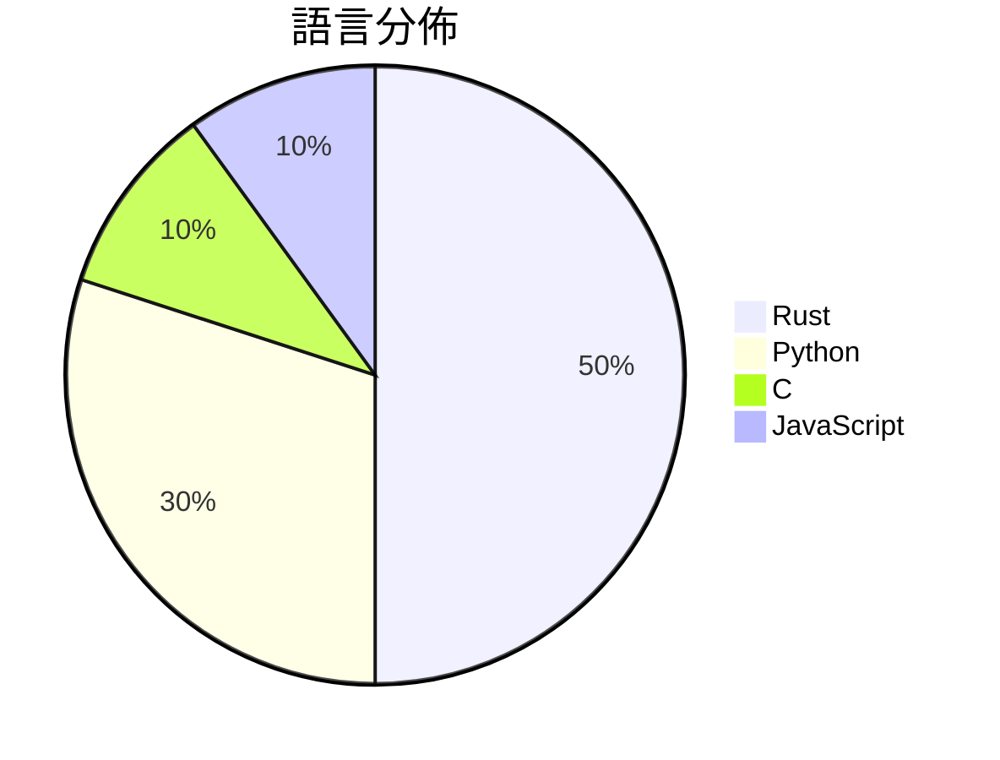

# GitHub Trending - 2026-11-25

> [!summary] 本日摘要
> 收錄 **10** 個新專案，合計 **41.4k** stars
> 語言分佈：Rust (5) · Python (3) · C (1) · JavaScript (1)

> [!tip] 本週焦點
> **[[Marvisak--VIctory|Marvisak/VIctory]]** — 1 天內累積 11.8k stars（11.8k stars/天）
> An attempt at running GTA VI on PC



---

## 收錄列表

| # | 專案 | 分類 | Stars | 速度 | 安裝 | 語言 | 用途 |
| :--: | --- | --- | ---: | ---: | --- | --- | --- |
| 1 | [[Marvisak--VIctory\|Marvisak/VIctory]] |  | 11.8k | 11.8k/天 |  | Rust | An attempt at running GTA VI on PC |
| 2 | [[xcl-dev--xcl\|xcl-dev/xcl]] |  | 8.0k | 2.0k/天 |  | Rust | Xbox Series compatibility layer for Wind |
| 3 | [[EL4CTEO--fast-anything\|EL4CTEO/fast-anything]] |  | 3.8k | 1.3k/天 |  | Rust | Don't rewrite it in Rust. Rewrite the 5% |
| 4 | [[AFK-surf--xnulinux\|AFK-surf/xnulinux]] |  | 3.7k | 915/天 |  | C | XNU as a loadable kernel module inside L |
| 5 | [[4lwayz--portwatch-vi\|4lwayz/portwatch-vi]] |  | 3.2k | 1.1k/天 |  | JavaScript | Does GTA VI run on PC yet? A live tracke |
| 6 | [[iamajmeena--neonclipping\|iamajmeena/neonclipping]] |  | 2.5k | 509/天 |  | Python | Paste a link, get captioned 9:16 clips i |
| 7 | [[fxceless--victory-fork\|fxceless/victory-fork]] |  | 2.5k | 2.5k/天 |  | Rust | Work-in-progress fork of VIctory: gettin |
| 8 | [[ubiquitarianism--leonida\|ubiquitarianism/leonida]] |  | 2.1k | 2.1k/天 |  | Python | A continuation of Leonida, the Xbox > PC |
| 9 | [[R0Y00--Xbox2Windows\|R0Y00/Xbox2Windows]] |  | 1.9k | 483/天 |  | Python | Static recompilation research for Xbox S |
| 10 | [[omonkeyz--xbox-emulator\|omonkeyz/xbox-emulator]] |  | 1.8k | 458/天 |  | Rust | Progress notes for running Xbox Series X |

---

## 重點摘要

### 1. [[Marvisak--VIctory|Marvisak/VIctory]]

**11.8k** stars · **11.8k** stars/天 · Rust

---

### 2. [[xcl-dev--xcl|xcl-dev/xcl]]

**8.0k** stars · **2.0k** stars/天 · Rust

---

### 3. [[EL4CTEO--fast-anything|EL4CTEO/fast-anything]]

**3.8k** stars · **1.3k** stars/天 · Rust

---

### 4. [[AFK-surf--xnulinux|AFK-surf/xnulinux]]

**3.7k** stars · **915** stars/天 · C

---

### 5. [[4lwayz--portwatch-vi|4lwayz/portwatch-vi]]

**3.2k** stars · **1.1k** stars/天 · JavaScript

---

### 6. [[iamajmeena--neonclipping|iamajmeena/neonclipping]]

**2.5k** stars · **509** stars/天 · Python

---

### 7. [[fxceless--victory-fork|fxceless/victory-fork]]

**2.5k** stars · **2.5k** stars/天 · Rust

---

### 8. [[ubiquitarianism--leonida|ubiquitarianism/leonida]]

**2.1k** stars · **2.1k** stars/天 · Python

---

### 9. [[R0Y00--Xbox2Windows|R0Y00/Xbox2Windows]]

**1.9k** stars · **483** stars/天 · Python

---

### 10. [[omonkeyz--xbox-emulator|omonkeyz/xbox-emulator]]

**1.8k** stars · **458** stars/天 · Rust

---

## 今日到期複習

> [!tip] 根據間隔複習排程，今天該回顧的專案

```dataview
TABLE
  stars_per_day AS "Stars/天",
  category AS "分類",
  engagement AS "參與度"
FROM "Repos"
WHERE next_review AND date(next_review) <= date("2026-11-25") AND status != "archived"
SORT priority DESC
```

## 待處理

```dataviewjs
const pending = dv.pages('"Repos"').where(p => p.status === "to-review").length;
const unrated = dv.pages('"Repos"').where(p => p.status !== "archived" && p.status !== "to-review" && (p.my_rating || 0) === 0).length;
const noVerdict = dv.pages('"Repos"').where(p => p.status !== "archived" && (p.my_rating || 0) > 0 && (!p.verdict || p.verdict === "")).length;
const items = [];
if (pending > 0) items.push(`**${pending}** 個待分流`);
if (unrated > 0) items.push(`**${unrated}** 個已讀但未評分`);
if (noVerdict > 0) items.push(`**${noVerdict}** 個已評分但無結論`);
if (items.length > 0) dv.paragraph(items.join(" / "));
else dv.paragraph("所有專案都已處理完畢！");
```
