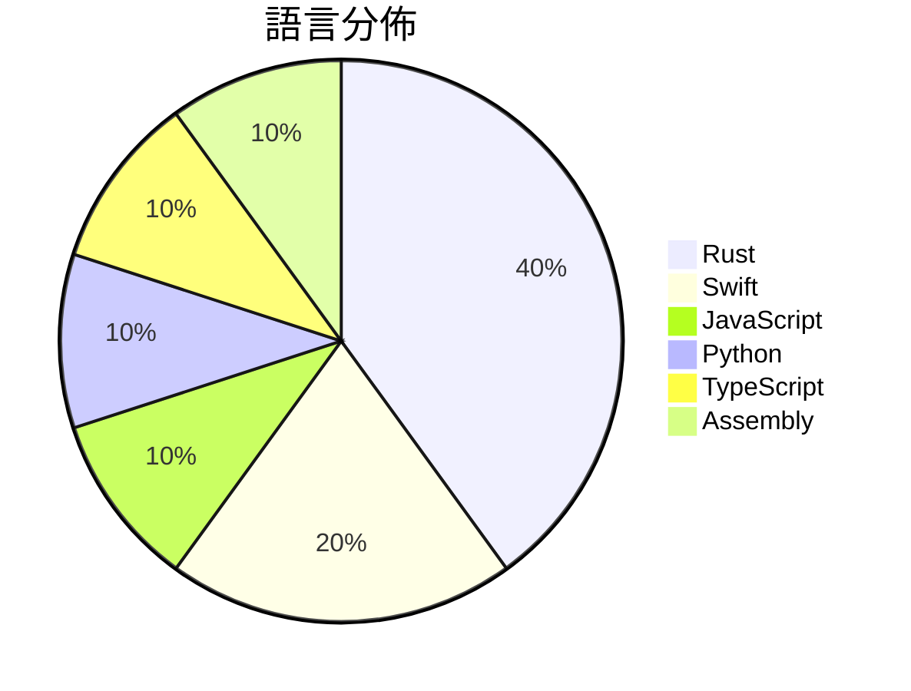

# GitHub Trending - 2026-11-28

> [!summary] 本日摘要
> 收錄 **10** 個新專案，合計 **45.2k** stars
> 語言分佈：Rust (4) · Swift (2) · JavaScript (1) · Python (1) · TypeScript (1) · Assembly (1)

> [!tip] 本週焦點
> **[[Marvisak--VIctory|Marvisak/VIctory]]** — 4 天內累積 13.9k stars（3.5k stars/天）
> An attempt at running GTA VI on PC



---

## 收錄列表

| # | 專案 | 分類 | Stars | 速度 | 安裝 | 語言 | 用途 |
| :--: | --- | --- | ---: | ---: | --- | --- | --- |
| 1 | [[Marvisak--VIctory\|Marvisak/VIctory]] |  | 13.9k | 3.5k/天 |  | Rust | An attempt at running GTA VI on PC |
| 2 | [[4lwayz--portwatch-vi\|4lwayz/portwatch-vi]] |  | 6.9k | 1.2k/天 |  | JavaScript | Does GTA VI run on PC yet? A live tracke |
| 3 | [[EL4CTEO--fast-anything\|EL4CTEO/fast-anything]] |  | 4.5k | 758/天 |  | Rust | Don't rewrite it in Rust. Rewrite the 5% |
| 4 | [[trustno1-coder--VIctory-NVIDIA\|trustno1-coder/VIctory-NVIDIA]] |  | 4.5k | 2.3k/天 |  | Rust | VIctory (Xbox Series compatibility layer |
| 5 | [[fxceless--victory-fork\|fxceless/victory-fork]] |  | 3.4k | 1.1k/天 |  | Rust | Work-in-progress fork of VIctory: gettin |
| 6 | [[ProjectLeonida--mandy\|ProjectLeonida/mandy]] |  | 3.0k | 758/天 |  | Python | A continuation of Leonida, the Xbox > PC |
| 7 | [[nexu-io--opengame\|nexu-io/opengame]] |  | 2.5k | 1.3k/天 |  | TypeScript | The Super Game Agent — the Unity & Unrea |
| 8 | [[alesha-pro--llm.asm\|alesha-pro/llm.asm]] |  | 2.4k | 799/天 |  | Assembly | Qwen3-0.6B inference (12 KB), bare-metal |
| 9 | [[os6--nospeaker\|os6/nospeaker]] |  | 2.0k | 400/天 |  | Swift | make your macbook's trackpad talk using  |
| 10 | [[Reukix--Reloc\|Reukix/Reloc]] |  | 2.0k | 977/天 |  | Swift | iOS accessory-level location simulator o |

---

## 重點摘要

### 1. [[Marvisak--VIctory|Marvisak/VIctory]]

**13.9k** stars · **3.5k** stars/天 · Rust

---

### 2. [[4lwayz--portwatch-vi|4lwayz/portwatch-vi]]

**6.9k** stars · **1.2k** stars/天 · JavaScript

---

### 3. [[EL4CTEO--fast-anything|EL4CTEO/fast-anything]]

**4.5k** stars · **758** stars/天 · Rust

---

### 4. [[trustno1-coder--VIctory-NVIDIA|trustno1-coder/VIctory-NVIDIA]]

**4.5k** stars · **2.3k** stars/天 · Rust

---

### 5. [[fxceless--victory-fork|fxceless/victory-fork]]

**3.4k** stars · **1.1k** stars/天 · Rust

---

### 6. [[ProjectLeonida--mandy|ProjectLeonida/mandy]]

**3.0k** stars · **758** stars/天 · Python

---

### 7. [[nexu-io--opengame|nexu-io/opengame]]

**2.5k** stars · **1.3k** stars/天 · TypeScript

---

### 8. [[alesha-pro--llm.asm|alesha-pro/llm.asm]]

**2.4k** stars · **799** stars/天 · Assembly

---

### 9. [[os6--nospeaker|os6/nospeaker]]

**2.0k** stars · **400** stars/天 · Swift

---

### 10. [[Reukix--Reloc|Reukix/Reloc]]

**2.0k** stars · **977** stars/天 · Swift

---

## 今日到期複習

> [!tip] 根據間隔複習排程，今天該回顧的專案

```dataview
TABLE
  stars_per_day AS "Stars/天",
  category AS "分類",
  engagement AS "參與度"
FROM "Repos"
WHERE next_review AND date(next_review) <= date("2026-11-28") AND status != "archived"
SORT priority DESC
```

## 待處理

```dataviewjs
const pending = dv.pages('"Repos"').where(p => p.status === "to-review").length;
const unrated = dv.pages('"Repos"').where(p => p.status !== "archived" && p.status !== "to-review" && (p.my_rating || 0) === 0).length;
const noVerdict = dv.pages('"Repos"').where(p => p.status !== "archived" && (p.my_rating || 0) > 0 && (!p.verdict || p.verdict === "")).length;
const items = [];
if (pending > 0) items.push(`**${pending}** 個待分流`);
if (unrated > 0) items.push(`**${unrated}** 個已讀但未評分`);
if (noVerdict > 0) items.push(`**${noVerdict}** 個已評分但無結論`);
if (items.length > 0) dv.paragraph(items.join(" / "));
else dv.paragraph("所有專案都已處理完畢！");
```
